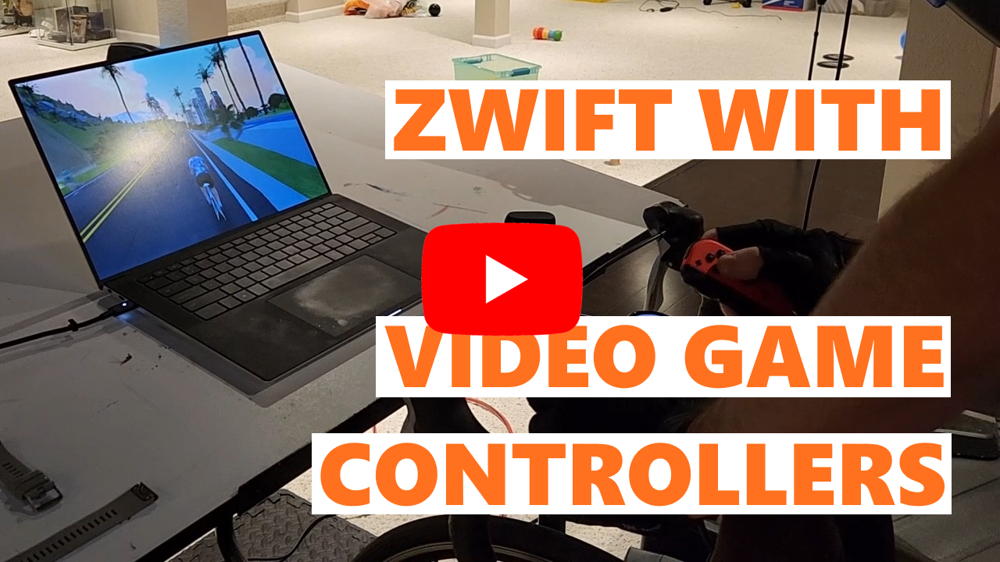
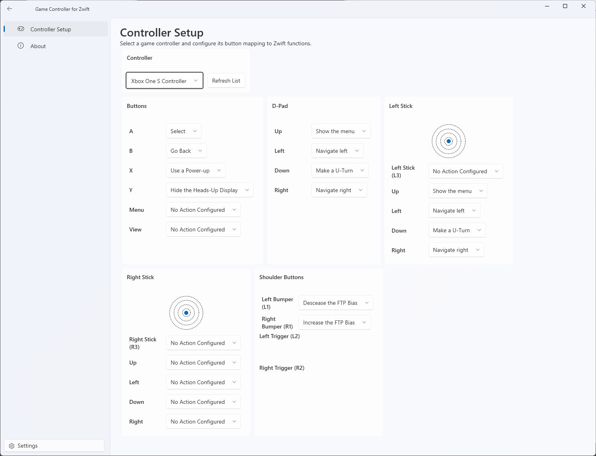
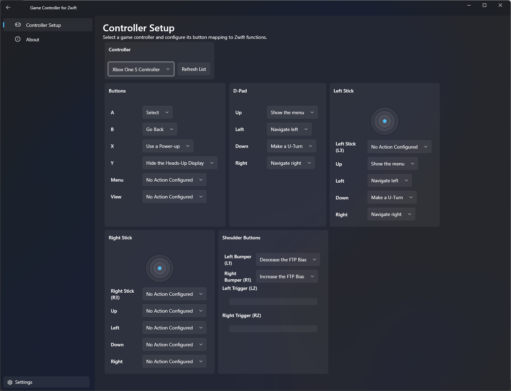

  

<h1 align="center">
  Game Controller For Zwift
</h1>

  A way to leverage your existing video game controllers with Zwift. Reduce electronic waste with this Windows application that runs locally on your Windows computer.

  
  &nbsp;
  
  &nbsp;
  
  &nbsp;
  

## Introduction

This project lets you use standard video game controllers with Zwift. It gives you the kind of control you get from Zwift-compatible controllers like the [Zwift Play Controllers](https://us.zwift.com/products/zwift-play?variant=43737779896576) or the [Wahoo Kickr Bike Shift](https://www.wahoofitness.com/devices/indoor-cycling/smart-bikes/kickr-bike-shift-buy): shifting, steering, braking and menu navigation. You can use controllers like Nintendo Switch Joy-Cons, Xbox controllers and other popular game controllers you already own.

The app shows up in Zwift as a Zwift Ride controller called **Voltage Gamepad**, over your local network. Zwift can run on the same Windows computer or on another device on the same network, such as a Mac, tablet or Apple TV.

Game Controller for Zwift uses one controller at a time, and treats a pair of connected Joy-Cons as a single controller.

  

## Quick start

1. Download the latest [release](https://github.com/VoltageSolutions/GameControllerForZwift/releases). Pick one package:
    - `GameControllerForZwift-<version>-win-x64-standalone.zip` works on its own. Choose this if you are not sure.
    - `GameControllerForZwift-<version>-win-x64.zip` is smaller and needs the .NET 10 Desktop Runtime. Windows offers the download if it is missing.
1. Unpack the zip and run `GameControllerForZwift.exe`. The app is not digitally signed yet, so if Microsoft Defender SmartScreen warns you, click **More info**, then **Run anyway**.
1. When Windows Firewall asks, allow the app on **private networks**.
1. Connect your controller and pick it in the app (use **Refresh List** if it is missing).
1. In Zwift's pairing screen, choose **Voltage Gamepad** as the **Power Source** first, so Zwift fills in **Controls**. Then switch Power Source, Resistance and Cadence to your trainer, and keep Controls on Voltage Gamepad. Ride On!

Full instructions are on the documentation site: [Install and first run](https://VoltageSolutions.github.io/GameControllerForZwift/use/install/), [Pair with Zwift](https://VoltageSolutions.github.io/GameControllerForZwift/use/pair-with-zwift/), [Map your controller](https://VoltageSolutions.github.io/GameControllerForZwift/use/map-your-controller/) and [Troubleshooting](https://VoltageSolutions.github.io/GameControllerForZwift/use/troubleshooting/).

  

    
    
Application in Light Mode

  

  

    
    
Application in Dark Mode

  

## Building from source

1. Install the .NET 10 SDK on Windows (for example with Visual Studio and the .NET desktop development workload).
1. Clone the repo.
1. Run `dotnet build GameControllerForZwift.sln`. The first build downloads the SDL2 native library.

See [Build and test](https://VoltageSolutions.github.io/GameControllerForZwift/build/build-and-test/) and [Architecture](https://VoltageSolutions.github.io/GameControllerForZwift/build/architecture/) for details.

## How it works

The app presents itself to Zwift as a Zwift Ride controller using mDNS discovery and Wahoo Direct Connect (Bluetooth GATT over TCP). The [How it works](https://VoltageSolutions.github.io/GameControllerForZwift/how-it-works/big-picture/) section documents the whole protocol, byte by byte, for anyone building a Zwift controller bridge in any language.

## How to contribute

### Ideas, Issues, or Bugs

Post to the [Issues page](https://github.com/VoltageSolutions/GameControllerForZwift/issues).

### Code

This project follows a modified version of Git Flow where `main` always represents the latest version. Submit a PR to the current version branch. Once it is tested, the version branch is merged to `main`, which creates a new release. See [Contributing](https://VoltageSolutions.github.io/GameControllerForZwift/build/contributing/).

### Credits

Thank you to the following people whose code or support helped make this possible.

- [Roberto Viola (aka cagnulein)](https://github.com/cagnulein): [qdomyos-zwift](https://github.com/cagnulein/qdomyos-zwift)
- [jonasbark](https://github.com/jonasbark): [BikeControl (formerly SwiftControl)](https://github.com/OpenBikeControl/bikecontrol)
- [OpenBikeControl](https://github.com/OpenBikeControl/openbikecontrol-protocol): the OpenBikeControl protocol
- [MattW2](https://github.com/MattW2): provided a [Wireshark capture](https://github.com/MattW2/KickrShiftKey/tree/main/KickrBikeWireShark) of Wahoo KICKR BIKE SHIFT talking to Zwift
- [Makinolo](https://www.makinolo.com/): [blog investigating Zwift Play and Ride devices](https://www.makinolo.com/blog/2024/07/26/zwift-ride-protocol/)

See [Credits](https://VoltageSolutions.github.io/GameControllerForZwift/how-it-works/credits/) for what each one helped us understand.

### Donate

Support this project on [ko-fi](https://ko-fi.com/voltagesolutions)!

## Roadmap

See the [Roadmap](https://VoltageSolutions.github.io/GameControllerForZwift/build/roadmap/) on the documentation site.

## Known Bugs and Issues

- Navigation within GameControllerForZwift is flaky. I've disabled the backstack until I can work it out.
- The trigger gauges do not show up well in light mode when not in use, so it may look like they aren't there at all.
- Windows 10 issues
  - Clicking around the app can highlight the entire window.
  - Dark-mode does not apply the intended color selections correctly.

## Technical Details

Please visit our [GitHub Pages site](https://VoltageSolutions.github.io/GameControllerForZwift) for more details.
