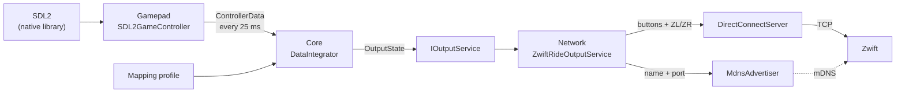

# Architecture

!!! tldr "TL;DR"
    The solution follows a light Clean Architecture layout. `Core` holds the domain types and the `DataIntegrator` that turns controller input into an `OutputState`. `Gamepad` reads controllers through SDL2, `Network` turns the output state into Zwift Ride frames over Wahoo Direct Connect and mDNS, and the WPF app wires everything together with dependency injection. A console tool, `ZwiftLanProbe`, runs the network side on its own for testing.

## Projects

| Project | Path | Responsibility |
|---|---|---|
| `GameControllerForZwift.Core` | `src/Application/` | Domain types: `ControllerData`, `ControllerInput`, `ZwiftFunction`, `InputMapping`, controller profiles, `OutputState` and the `IInputService` and `IOutputService` interfaces. Also the `DataIntegrator`, which polls the controller, applies the mapping and pushes the result to the output. |
| `GameControllerForZwift.Gamepad` | `src/Infrastructure/` | Reads game controllers with SDL2 (`SDL2InputService`, `SDL2GameController`), including battery level. Loads the mapping profile (`ControllerProfileService`). Downloads the native SDL2 library at build time. |
| `GameControllerForZwift.Network` | `src/Infrastructure/` | Presents the app to Zwift as a Zwift Ride: `ZwiftRideOutputService` (the `IOutputService`), `DirectConnectServer` and `DirectConnectSession` (Wahoo Direct Connect over TCP), `ZwiftControlProtocol` (handshake, replies and keypad frames), `ZwiftRideProfile` (advertisement and GATT tree) and `MdnsAdvertiser`. Depends only on the logging abstractions, not on WPF. |
| `GameControllerForZwift` (WPF app) | `src/Presentation/` | The Windows app: pages, view models, controls, dependency injection setup and logging providers. |
| `ZwiftLanProbe` | `tools/` | A console app that runs the Direct Connect server and mDNS advertiser on their own, driven from the keyboard. See [ZwiftLanProbe](probe.md). |
| Tests | `tests/` | Unit, integration and UI tests. See [Build and test](build-and-test.md#tests). |

## How input flows

1. `DataIntegrator.ReadDataAsync` reads a `ControllerData` snapshot every 25 ms and puts it in a small queue (the oldest entry is dropped when it holds 10).
2. `DataIntegrator.WriteDataAsync` takes each snapshot, raises `InputPolled` for the UI, and applies the mapping. Each input gives a value from 0 to 1. Steer left and right combine into one steering value from -1 to 1, and the strongest input wins for brake and steering.
3. The result is an `OutputState`: the set of pressed functions, steering, brake and the controller's battery level. It goes to `IOutputService.UpdateAsync`, which must be cheap and non-blocking.
4. `ZwiftRideOutputService` turns the state into a Zwift Ride button mask (`ButtonMap`) and two paddle values (`PaddleMath`). A send loop wakes on change, repeats every 100 ms while anything is active and sends one neutral frame on release.
5. `DirectConnectServer` sends the frame to the connected Zwift session and resends the latest frame every 5 seconds as a keepalive.

The core never knows about the network. Any other `IOutputService` could be plugged in without touching `Core` or `Gamepad`.

## Startup and shutdown

`App.OnStartup` builds the service provider, shows the main window and then starts `ZwiftRideOutputService` on a background task. Starting means:

1. Bind the Direct Connect TCP listener (port 36866, or the next free port up to 36876).
2. Start the mDNS advertisement with the port that was actually bound.
3. Start the send loop.

On exit, disposing the service provider stops the service: the mDNS goodbye is sent, the send loop stops and the TCP server closes.

## Dependency injection

All services are registered in `App.ConfigureServices` with `Microsoft.Extensions.DependencyInjection`. Most are singletons.

| Registration | Implementation |
|---|---|
| `IInputService` | `SDL2InputService` |
| `IControllerProfileService` | `ControllerProfileService`, loaded from `defaultprofile.json` next to the exe |
| `DeviceIdentity` | Default identity with the name `Voltage Gamepad` |
| `IZwiftRideLink` | `DirectConnectServer` |
| `MdnsAdvertiser` | `MdnsAdvertiser` |
| `ZwiftRideOutputService` and `IOutputService` | The same `ZwiftRideOutputService` instance |
| `IDataIntegrator` | `DataIntegrator` |
| View models, pages and `MainWindow` | Registered for constructor injection |

## Logging

The app uses `Microsoft.Extensions.Logging` with two providers:

| Provider | Where it writes | Level |
|---|---|---|
| Event Log (`CustomMessageEventLogLoggerProvider`) | Windows Event Log, **Application** log | Information and above |
| File (`FileLoggerProvider`) | `logs\app-yyyyMMdd-HHmmss.log` under `AppContext.BaseDirectory` (the folder of the exe) | Information and above, plus Debug for the `GameControllerForZwift.Network` categories |

At Debug level the network code logs every Direct Connect message (message id, sequence, response code, characteristic UUID and value as hex), every keypad frame with a decoded summary, and the mDNS queries it hears. This makes the file log the first thing to ask for when a user reports a pairing problem.

The Network library only references `Microsoft.Extensions.Logging.Abstractions` and uses source-generated `[LoggerMessage]` methods.
