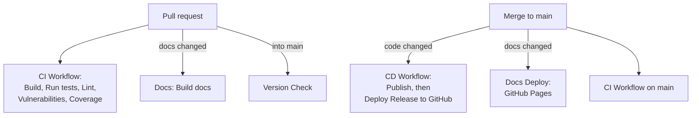

# CI and CD

!!! tldr "TL;DR"
    Every pull request runs the CI Workflow: build, tests, formatting, security checks and coverage. Pull requests into `main` also get a Version Check, and documentation changes get a docs build. When a change lands on `main`, the CD Workflow builds both download packages and publishes a GitHub release straight away, unless the change only touched docs. Docs changes on `main` deploy the documentation site.

## Checks on a pull request

| Check | Workflow | What it means |
|---|---|---|
| **CI Workflow / Build** | `ci.yml` | Restores and builds the whole solution in Release on Windows, publishes both packages (framework-dependent and standalone) and checks the publish output, including that `SDL2.dll` is present. |
| **CI Workflow / Run tests** | `ci.yml` | Runs the unit and integration tests with coverage, then the UI tests with Appium and WinAppDriver. Fails if any test fails **or is skipped**. |
| **CI Workflow / Lint** | `ci.yml` | On Linux, runs `dotnet format --verify-no-changes` on the libraries, the portable test projects and the probe, then builds them. |
| **CI Workflow / Vulnerabilities** | `ci.yml` | Runs a CodeQL analysis of the shipping projects and checks NuGet packages for known vulnerabilities. High or critical findings fail the check. |
| **CI Workflow / Coverage** | `ci.yml` | Uploads the coverage reports to Codecov. Fails if the test job produced no coverage. |
| **Unit Test Results** | `ci.yml` | A summary of the unit and integration test results, with failed tests listed. |
| **UI Test Results** | `ci.yml` | The same summary for the UI tests. |
| **codecov/project** | Codecov | Overall coverage must stay at or above the project target (40%). |
| **codecov/patch** | Codecov | Lines changed in the pull request must reach the patch target (60%). |
| **Code scanning results / CodeQL** | GitHub code scanning | New CodeQL alerts introduced by the pull request. |
| **Version Check** | `ci.yml` | Only on pull requests into `main`. Passes when `<Version>` is new (no tag exists yet) or when the change is docs only. Fails when a release for that version already exists. |
| **Docs / Build docs** | `docs.yml` | Only when `docs/**`, `mkdocs.yml` or the docs workflow change. Builds this site with `mkdocs build --strict`, so any warning fails. |

!!! note "Checks can appear under another workflow's name"
    **Unit Test Results**, **UI Test Results** and **Version Check** are created through the GitHub API by a step inside the CI Workflow. GitHub sometimes lists API-created checks under a different workflow in the checks panel. The check name is what matters.

Pull requests from forks cannot create these API checks. For forks, the test summaries and the version result only appear in the job summary.

## When a change lands on `main`

### CD Workflow

`cd.yml` runs on every push to `main`, except pushes that only change `docs/**`, `mkdocs.yml` or Markdown files.

| Job | What it does |
|---|---|
| **Publish** | Reads `<Version>` from the WPF project. If a `v<version>` tag already exists, it stops and nothing is released. Otherwise it builds, publishes and zips both packages, and writes `SHA256SUMS.txt`. |
| **Deploy Release to GitHub** | Creates the GitHub release `v<version>` with both zips and the checksum file. |

The release is published **immediately**: there is no draft step. The two packages are:

- `GameControllerForZwift-<version>-win-x64.zip`: framework-dependent, needs the .NET 10 Desktop Runtime.
- `GameControllerForZwift-<version>-win-x64-standalone.zip`: self-contained single file, needs nothing else.

### Docs Deploy

`docs-deploy.yml` runs when docs files change on `main` (or by hand). It builds the site with `mkdocs build --strict` and deploys it to GitHub Pages.

## Workflow overview

