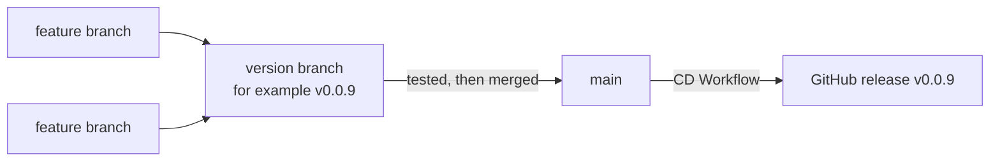

# Contributing

!!! tldr "TL;DR"
    Report ideas and bugs on the Issues page. For code, open a pull request into the current version branch, keep every check green, and bump `<Version>` for code changes that go to `main`.

Thank you for helping. Ideas, bug reports and pull requests are all welcome.

## Ideas and bugs

Post them on the [Issues page](https://github.com/VoltageSolutions/GameControllerForZwift/issues). For a bug, include what you did, what you expected, what happened, and the app's log file (see [Find and share the log file](../use/troubleshooting.md#find-and-share-the-log-file)).

## Branch flow

`main` always holds the latest released version. Work flows into it through a version branch:



1. Create a feature branch for your change.
2. Open a pull request into the current **version branch** (for example `v0.0.9`). If you are not sure which one, ask in your pull request.
3. Once the version is ready and tested, the version branch is merged into `main`. That merge creates the release.

## Versioning

The app's version lives in one place: the `<Version>` element in `src/Presentation/GameControllerForZwift/GameControllerForZwift.csproj`.

- Every pull request into `main` that changes code must carry a **new** version. The **Version Check** fails if a release with that version already exists.
- Docs-only pull requests do not need a new version.
- When the merge to `main` lands, the CD Workflow tags `v<version>` and publishes the release. See [CI and CD](ci-cd.md).

## What we expect in a pull request

- **All checks are green.** See [CI and CD](ci-cd.md) for what each check means.
- **No warnings.** The build treats warnings as errors, so a warning fails CI.
- **Formatting is clean.** Run `dotnet format --verify-no-changes` on the projects you touched.
- **Tests for new behaviour.** Add or update tests in the matching test project. Skipped tests fail CI, so do not leave tests skipped.
- **Coverage holds up.** New and changed lines should be covered (the patch target is 60%).
- **Docs follow the code.** If you change behaviour that riders or protocol readers rely on, update the matching page on this site.

## Writing docs

This site is built with Material for MkDocs from the `docs/` folder. To preview it locally:

```bash
pip install -r docs/requirements.txt
mkdocs serve
```

Diagrams are written as Mermaid code blocks, so they live in the repository as plain text and show up in reviews like any other change. Keep the build clean with `mkdocs build --strict`.

## Support the project

You can also support the project on [ko-fi](https://ko-fi.com/voltagesolutions).
