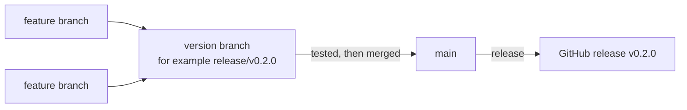

# Contributing

!!! tldr "TL;DR"
    Report ideas and bugs on the Issues page. For code, open a pull request into the current version branch, and keep every check green. The version is set for you on each release branch.

Thank you for helping. Ideas, bug reports and pull requests are all welcome.

## Ideas and bugs

Post them on the [Issues page](https://github.com/VoltageSolutions/GameControllerForZwift/issues). For a bug, include what you did, what you expected, what happened, and the app's log file (see [Find and share the log file](../use/troubleshooting.md#find-and-share-the-log-file)).

## Branch flow

`main` always holds the latest released version. Work flows into it through a version branch:



1. Create a feature branch for your change.
2. Open a pull request into the current **version branch** (for example `release/v0.2.0`). If you are not sure which one, ask in your pull request.
3. Once the version is ready and tested, the version branch is merged into `main`. That merge creates the release.

## Versions and release branches

The app's version lives in one place: the `<Version>` element in `windows/Directory.Build.props`. Every project picks it up from there.

- **After each release**, the branch for the next minor version is opened automatically, with the version already set. For example, releasing `v0.3.0` opens `release/v0.4.0` with version `0.4.0`.
- **For a patch or major release**, I create `release/vX.Y.Z` by hand from `main` (for example `release/v0.3.1` or `release/v1.0.0`). The Release Branch workflow sets the version to match the branch name. The version must be higher than the latest release, or the workflow fails.
- **When I go to a new major version**, I delete the minor branch that was opened automatically and is no longer needed.
- **The Version Check** on pull requests enforces this:
    - Into a release branch, the version must match the branch name. If it does not, your branch is probably based on an older release branch.
    - Into `main`, the version must be higher than the latest release and match the release branch name.
    - Docs-only pull requests pass without a version change.
- When the merge to `main` lands, the release `v<version>` is published.

## What a pull request needs

Pull requests run automated checks; keep them green.

- **No warnings.** The build treats warnings as errors.
- **Formatting is clean.** Run `dotnet format --verify-no-changes` on the projects you touched.
- **Tests for new behavior.** Add or update tests in the matching test project. Do not leave tests skipped.
- **Coverage holds up.** New and changed lines should be covered (the patch target is 60%).
- **Docs follow the code.** If you change behavior that riders or protocol readers rely on, update the matching page on this site.
- **Screenshots for UI changes.** If the pull request changes what the app looks like, embed screenshots in its description, so a reviewer does not need to build it. Show each changed screen in light and dark mode, plus the states or window sizes that matter, about six images. Drag them into the description on GitHub; they do not go into the repository.

## Writing docs

This site is built with [Zensical](https://zensical.org) from the `docs/` folder. To preview it locally:

```bash
pip install -r docs/requirements.txt
zensical serve
```

Diagrams are written as Mermaid code blocks, so they live in the repository as plain text and show up in reviews like any other change. Keep the build clean with `zensical build --clean --strict`.

## Support the project

You can also support the project on [ko-fi](https://ko-fi.com/voltagesolutions).
