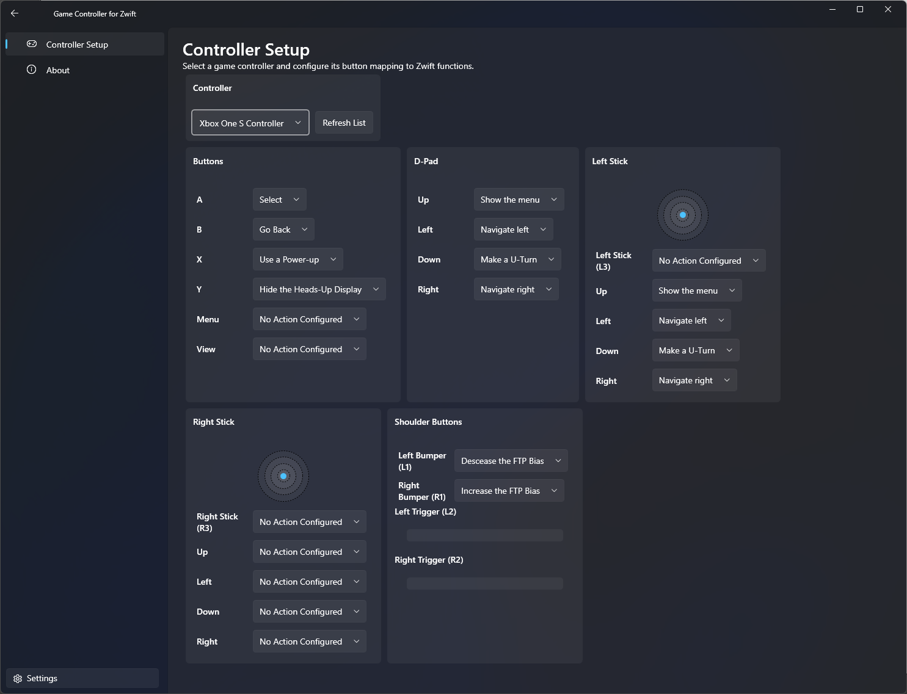
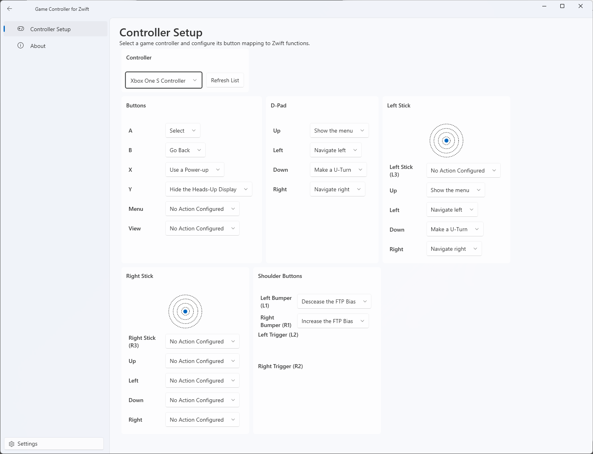

# UX concepts

!!! tldr "TL;DR"
    This page reviews the current WPF app and compares it with BikeControl, a modern Flutter app in the same space. The current app is one dense page of 24 drop-downs with no connection status or first-run guidance. The recommended direction is a short guided setup, then a single dashboard with always-visible status and a visual controller mapper. The page ends with a design brief: users, key tasks, layout options and the states to design for.

## 1. The current WPF app

The app lives in `src/Presentation/GameControllerForZwift`. Keyboard output, the "Send to" card and the long legacy function list are gone. The function list is now: No action, Navigate Up, Down, Left and Right, Select (A), Back / Menu (B), Power-up (Y), Ride On (Z), Shift up, Shift down, Steer left, Steer right and Brake.

### Shell and navigation

- `MainWindow.xaml` has a custom title bar (44 px row) with a back arrow, a 20 px logo, the caption "Game Controller for Zwift" and hand-drawn minimise, maximise and close buttons using Segoe Fluent glyphs (`WindowChrome`). Default size 1600 x 800, minimum 400 x 450.
- The left pane is a `TreeView` (not a `NavigationView`) fed from `Navigation/PagesInfoData.json`, with "Controller Setup" and "About". "Settings" is a 250 px wide button pinned bottom left.
- Content is a `Frame` inside a `Border` with an 8 px top-left radius and the layer fill brush. Back navigation uses the `NavigationService`.
- There is no status bar, no header chips and no persistent connection indicator.

### Screens

1. **Controller Setup** (`Views/ControllerSetupPage.xaml`), the only real screen. A title and description, then a `WrapPanel` of cards:
    - **Controller:** a combo box of detected controllers and a "Refresh List" button.
    - **Reset** and **Profile** cards exist in the XAML but are commented out.
    - **Mapping cards**, each a list of `InputMapper` rows (an 80 px label and a function combo box). A row highlights while its physical input is pressed. This is the only live input display.
        - Buttons: A, B, X, Y, Menu, View.
        - D-Pad: Up, Left, Down, Right.
        - Left Stick: a live `ThumbstickGraph` (100 x 100 concentric circles with a dot), L3 click and four tilt rows.
        - Right Stick: the same, with R3.
        - Shoulder Buttons: L1, R1, L2, R2 rows and two `GaugeControl` bars for the analog triggers.
    - That is 24 drop-downs on one page.
2. **Settings** (`Views/SettingsPage.xaml`): one setting, "App theme" (Light, Dark or Use system). A large commented-out block still holds template text from the WPF Gallery sample.
3. **About** (`Views/AboutPage.xaml`): title and logo, GitHub and Ko-fi buttons, and the acknowledgements rendered from `ACKNOWLEDGEMENTS.md` with Markdig.Wpf.
4. `Views/ControllerMapping/ZwiftFunction.xaml` is an orphan `UserControl` that looks unused.

### Controls

`Card` (title, subtitle and content, 6 px radius), `InputMapper` (name, combo box and pressed highlight), `ThumbstickGraph` (drawn in code, with hard-coded black strokes that are hard to see in dark mode) and `GaugeControl` (a bar drawn in code). There is no controller picture anywhere.

### Theming

- The native WPF Fluent theme (`PresentationFramework.Fluent` in .NET 10), not a third-party library. Colours come from Fluent system brushes such as `CardBackgroundFillColorDefaultBrush` and `AccentFillColorSelectedTextBackgroundBrush`. The accent is the user's Windows accent colour.
- A Dark, Light or System switch in Settings (default "Use system").
- `Typography.xaml` uses Segoe UI Variable. Sizes: Caption 12, Body 14, Subtitle 20, Title 28, TitleLarge 40. Most styles are semibold, which feels heavy.
- Icons are Segoe Fluent Icons glyphs, plus a GitHub path geometry and the Ko-fi SVG.
- `Resources/Colors.xaml` is nearly empty. The app has no brand palette of its own.

### Live status: what exists and what does not

- **Exists:** per-input pressed highlight, live thumbstick position, live trigger gauges, controller list with refresh.
- **Missing from the UI:** Zwift connection state, network status (address and port), a controller connected indicator, battery level, controller type, errors and toasts, output activity (what was sent to Zwift), onboarding, profile save, load and reset, and a test mode.

### Pain points

- No first-run guidance. Users must already know to pair "Voltage Gamepad" in Zwift.
- One dense wall of near-identical drop-downs. Long labels such as "Right Bumper (R1)" wrap awkwardly, and cards of uneven height make a ragged layout.
- Abstract names (Up, Left, Down, Right appear under three groups) instead of a controller picture.
- Black strokes in the thumbstick graph in dark mode, a `TreeView` used for navigation, a hand-made title bar, a nearly empty Settings page and leftover template text.
- Cards have titles only, no status chips and little depth.

## 2. Screenshots of the current app

The dark mode screenshot shows the left tree with "Controller Setup" selected and "About", with Settings pinned at the bottom. The Controller card holds the selected controller and Refresh List. Below it are rows of cards: Buttons, D-Pad, Left Stick (a target with a blue dot), Right Stick and Shoulder Buttons. The right side of the window is empty. It reads like a settings form.

## 3. BikeControl for comparison

BikeControl is a Flutter app (built with shadcn_flutter and the Geist font) that connects bike controllers to trainer apps. It is a useful reference for a modern, friendly layout.

### Structure

- **Sidebar** with the brand mark, nav items (Ride, Devices, Activity, Settings) and a filled pill for the selected item. A compact variant on phones.
- **Top bar** with the page title and two status chips on the right, for example "Controller 81%" and "Smart Trainer to Trainer app". The connection summary and battery are always visible.
- **Ride (home):** a "Ready to ride" banner that turns into a to-do list when setup is incomplete, a virtual shifting card with a large gear number, and a "Your buttons" panel with a controller drawing and a list of button to action rows.
- **Devices:** grouped sections (Controllers, Smart trainer, Trainer app). Each row has an icon, name, details such as firmware and signal, a status dot with words ("Connected") and a chevron. A "Connect controllers" row hints "Wake it with a button press first."
- **Controller settings:** a device header with status, battery and firmware, then a controller drawing with coloured buttons and small badges showing the assigned action. Tapping a button opens its details.
- **Onboarding:** a step rail on the left with Back and Continue. Steps cover the app, where it runs, the controller, virtual shifting, the connection and a done screen.
- **Other:** bottom sheets, toasts, skeleton loaders, a help centre and a network troubleshooting page.

### Palette

- Brand blue `#0E74B7` with a teal gradient end `#0E9297`. Dark mode primary `#4DA9E8`.
- Light: page `#F2F2F7`, card `#FFFFFF`, text `#1C1C1E`, muted text `#636366`, border `#DCDCE0`.
- Dark: page `#101318`, card `#1B1F25`, secondary fill `#262B33`, border `#2A3038`, text `#FFFFFF`, muted text `#A3A3A3`.
- Status colours (light / dark): success `#147A3B` / `#22C55E`, warning `#B45309` / `#FBBF24`, info `#1D4ED8` / `#93C5FD`, danger `#B91C1C` / `#FC8C8C`.
- Controller button art: A green, B pink, Y blue, Z orange, D-pad black.

### Typography and shape

- Geist Sans for text and Barlow Condensed for display numbers and capitalised section labels. Tabular figures on live numbers.
- Cards with a 16 px radius, separated by tone rather than outlines, with a soft shadow in light mode.
- Status shown as a dot plus words, not tinted pills. Lucide line icons. Motion that respects reduced-motion settings. Contrast checked against 4.5:1.

### What makes it feel modern

1. Always-visible status chips, including battery.
2. One "Ready to ride" banner that becomes a to-do list.
3. A controller drawing is the mapping UI.
4. Large condensed numbers for live data.
5. Tonal cards, generous padding, one accent colour plus status colours, in light and dark.
6. Guided onboarding with a step rail.
7. Short plain-language helper text on every empty state.

## 4. Design brief

### Users

Zwift riders with an Xbox, PlayStation, Switch or 8BitDo controller who want shifting and steering without buying more hardware. Mostly non-technical. Zwift runs on the same Windows PC or on another device on the same network. Setup happens once in a while, then the app should sit quietly in the background. A smaller group of tinkerers will remap a lot.

### Key tasks

1. **First run:** understand what the app does, plug in a controller, pair "Voltage Gamepad" in Zwift and see that it worked.
2. **Pick or refresh** the controller, and cope with a swap or disconnect.
3. **Map** buttons, sticks and triggers to the Zwift functions, with sensible defaults and a reset.
4. **Check live input:** press a button and see it light up.
5. **At a glance:** is Zwift connected, is the controller connected, how is the battery?

### Layout options

- **A. Single dashboard with a mapping drawer.** One home screen with a status header (controller with battery, Zwift), the controller picker and a compact list of Zwift functions with their assigned inputs. Clicking a row opens a side drawer to change it, either "press the button you want" or pick from a list. Settings and About go in a footer or overflow menu. The fewest screens, which suits the small function list.
- **B. Guided setup, then the dashboard.** On first launch, four steps (Welcome, Choose controller, Pair with Zwift, Test and done), then the dashboard from A. A banner reopens the setup guide when something is not ready.
- **C. Visual controller mapper.** A controller illustration in the centre with live highlights and action badges. Click a part to assign it. A side panel lists the functions and offers a "learn by pressing" mode. Status chips at top right. The richest option, but it needs artwork and handling of non-Xbox layouts.
- **Recommended:** B and C inside A's frame. Guided setup once, then a dashboard whose main panel is the visual mapper, with a list view as a fallback.

### Navigation

Either no sidebar (a single dashboard plus a settings sheet) or a slim icon sidebar with Home, Settings and About. Replace the `TreeView` and the hand-made title bar with a standard Fluent title bar or a cleaner custom one.

### States to design

- **Zwift link:** not found or not paired (with instructions and the "Voltage Gamepad" name), waiting for Zwift, connected, connection lost.
- **Controller:** none detected (with a plug-in hint and Refresh), detected but not selected, connected with battery (wired means no battery, plus a low battery warning), disconnected mid-session, several controllers to pick from.
- **Mapping:** defaults loaded, editing one binding (listening for a press), conflict (input already used, offer a swap), missing function warning (for example no shift mapped), reset confirmation.
- **Live input:** button highlight, stick movement with dead zone, trigger gauge, a test mode banner, an "action sent" toast (for example "Shift up sent to Zwift").
- **Chrome:** light and dark, first-run welcome, settings (theme, start with Windows, minimise to tray), about and donate, narrow (400 px) and wide (1600 px) windows.

!!! note "Data the design needs"
    The Zwift connection state is available from the network layer (`ZwiftRideOutputService.ConnectionChanged` and `IsZwiftConnected`), and the battery level is part of `ControllerData`. Neither is shown in the UI yet, so the view models will need to expose them.
