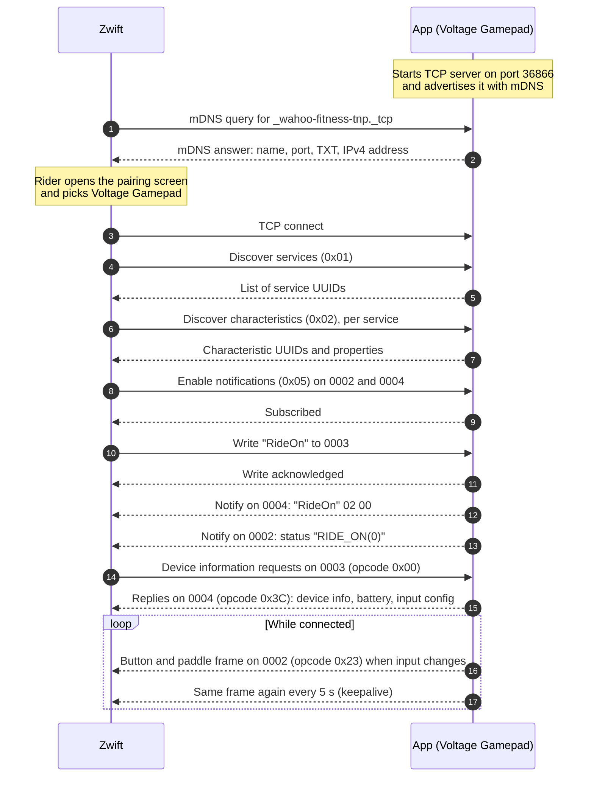
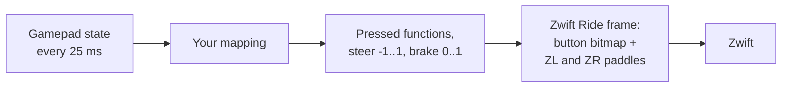

# The big picture

!!! tldr "TL;DR"
    The app pretends to be a Zwift Ride controller on your local network. It announces itself with mDNS, accepts a TCP connection from Zwift, and speaks Wahoo Direct Connect, which carries Bluetooth GATT operations over TCP. After a short "RideOn" handshake and a few device information requests, the app sends button and paddle frames whenever your controller changes, plus a keepalive every 5 seconds.

This section is for anyone who wants to understand, debug or reimplement the link between a controller and Zwift. Nothing here is specific to C#. If you can open a TCP socket and send a multicast UDP packet, you can build the same thing in any language.

## Three layers

| Layer | What it does | Page |
|---|---|---|
| mDNS | Lets Zwift find the device on the local network. | [mDNS discovery](mdns.md) |
| Wahoo Direct Connect | Carries Bluetooth GATT operations (discover, read, write, subscribe, notify) over a TCP connection. | [Direct Connect](direct-connect.md) |
| Zwift controller protocol | The bytes Zwift and a Zwift Ride exchange on Zwift's own GATT characteristics: handshake, device information, button frames. | [Zwift controller protocol](zwift-protocol.md) |

## A pairing session from start to finish

Zwift does not wait for each answer before sending the next request. It sends discovery, subscription and the RideOn write in one quick burst. The [Direct Connect page](direct-connect.md#pipelining-and-queued-notifications) explains how the app copes with that.

## Why present as a Zwift Ride?

Zwift already knows how to use a Zwift Ride. It has a D-pad, A, B, Y and Z buttons, two shifters on each side and two analog paddles (ZL and ZR) that steer when tilted outward and brake when squeezed inward. That covers everything a rider needs from a game controller: menus, shifting, steering and braking.

Presenting as a Zwift Ride has two big advantages:

- **It sits next to your trainer.** A Zwift Ride is a pure controller. Zwift pairs it under **Controls** while your trainer stays the Power Source and Resistance device, and Zwift's virtual shifting then drives your trainer.
- **No new protocol.** The app uses formats Zwift already understands, so it works on every platform Zwift runs on, including tablets and Apple TV, with no plugin or companion app.

## What the app actually sends

The app reads the controller every 25 ms. When the resulting frame changes, it sends it at once. While anything is pressed it repeats the frame every 100 ms, and when you let go it sends one neutral frame. On top of that, the current frame goes out every 5 seconds as a keepalive. Details are on the [Zwift controller protocol page](zwift-protocol.md#timing).
