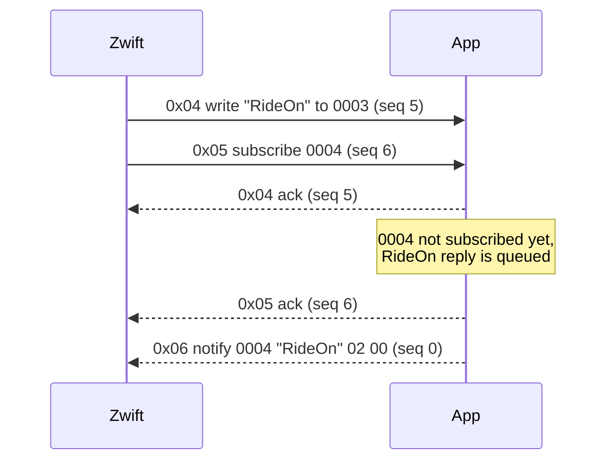

# Wahoo Direct Connect

!!! tldr "TL;DR"
    Wahoo Direct Connect (often shortened to DIRCON) is Bluetooth LE GATT carried over a plain TCP connection. Every message is a 6-byte header followed by a payload, and UUIDs always travel as 16 raw bytes. There are six message types: discover services, discover characteristics, read, write, enable notifications and notification. Responses echo the request's sequence number, notifications use sequence 0, and a notification must wait until the client has subscribed to that characteristic.

## The idea

A Bluetooth LE device exposes **services**, and each service holds **characteristics** that can be read, written or subscribed to. This is called GATT. Direct Connect takes those same operations and sends them as small binary messages over TCP. Zwift then treats the network device exactly like a Bluetooth one.

The app is the **server**: it listens on a TCP port (36866 by default) and Zwift connects to it. One Zwift connection is active at a time. If a new connection arrives, it replaces the old one.

## The header

Every message, in both directions, starts with the same 6 bytes.

| Offset | Size | Field | Notes |
|---|---|---|---|
| 0 | 1 | Version | Always `1`. |
| 1 | 1 | Message id | `0x01` to `0x06`, see below. |
| 2 | 1 | Sequence number | Chosen by the client for requests. Echoed in the response. `0` for notifications. |
| 3 | 1 | Response code | `0` in requests and notifications. The result in responses. |
| 4 | 2 | Payload length | Unsigned 16-bit, **big-endian**. Number of bytes after the header. |
| 6 | n | Payload | Depends on the message id. |

```text
01 05 03 00 00 11 | 00 00 00 02 19 CA 46 51 86 E5 FA 29 DC DD 09 D1 01
|  |  |  |  |___|   |______________________________________________| |
|  |  |  |  length   characteristic UUID (16 bytes)                   enable = 1
|  |  |  response code 0
|  |  sequence 3
|  message id 0x05 (enable notifications)
version 1
```

!!! tip "Read the stream, not single packets"
    TCP is a byte stream. One read can hold half a message or several messages. Buffer the incoming bytes and only handle a message once you have `6 + length` bytes.

## UUIDs on the wire

UUIDs are always 16 bytes in their normal written order (big-endian), with no dashes. A 16-bit Bluetooth UUID such as `0xFC82` is expanded on the Bluetooth base UUID:

```text
0xFC82  ->  0000FC82-0000-1000-8000-00805F9B34FB
        ->  00 00 FC 82 00 00 10 00 80 00 00 80 5F 9B 34 FB
```

!!! note "Do not use a .NET Guid for UUID bytes"
    `System.Guid.ToByteArray()` stores the first three groups in little-endian order. The app uses its own `BleUuid` type that keeps the bytes in wire order.

## Message types

| Id | Name | Direction | Request payload | Success response payload |
|---|---|---|---|---|
| `0x01` | Discover services | Client to server | Empty | N service UUIDs, 16 bytes each |
| `0x02` | Discover characteristics | Client to server | Service UUID (16) | Service UUID (16), then for each characteristic: UUID (16) + properties (1) |
| `0x03` | Read characteristic | Client to server | Characteristic UUID (16) | Characteristic UUID (16) + value |
| `0x04` | Write characteristic | Client to server | Characteristic UUID (16) + data | Characteristic UUID (16) |
| `0x05` | Enable notifications | Client to server | Characteristic UUID (16) + 1 byte (`1` on, `0` off) | Characteristic UUID (16) |
| `0x06` | Notification | Server to client | Not a request | Characteristic UUID (16) + data, sequence 0 |

### Characteristic properties

The single properties byte in a "discover characteristics" response is a bit mask:

| Bit | Value | Meaning |
|---|---|---|
| 0 | `0x01` | Read |
| 1 | `0x02` | Write |
| 2 | `0x04` | Notify |
| 3 | `0x08` | Indicate |

Bits combine. For example `0x0A` means write and indicate.

### Response codes

| Code | Meaning | When the app sends it |
|---|---|---|
| `0` | Success | The request worked. |
| `1` | Unknown message type | Defined by the protocol. The app answers unknown ids with `2` instead. |
| `2` | Unexpected error | Unknown message id, or a payload that is too short. |
| `3` | Service not found | Discover characteristics for a service the app does not have. |
| `4` | Characteristic not found | Read, write or subscribe for an unknown characteristic. |
| `5` | Operation not supported | For example a read on a characteristic without the read property. |
| `6` | Write failed, invalid size | Defined by the protocol, not used by the app. |
| `7` | Unknown protocol version | Defined by the protocol, not used by the app. |

Error responses carry an empty payload, so they are exactly 6 bytes long. A message from the client with a non-zero response code is ignored.

## Sequence numbers

- A **response** copies the sequence number of the request it answers. That is how the client matches answers to questions.
- A **notification** (`0x06`) always uses sequence number `0`.

## Subscriptions and queued notifications

A notification for a characteristic may only be sent after the client has enabled notifications for it with `0x05`. The app keeps a set of subscribed characteristics per connection.

If the app wants to notify a characteristic that is not subscribed yet, it does one of two things:

- **Handshake replies are queued.** Replies to Zwift's requests (for example the RideOn reply) wait in a small queue for that characteristic (up to 64 messages). When Zwift subscribes, the app sends the subscribe response first and then flushes the queue in order.
- **Button frames are dropped.** Live controller frames are not queued. A stale button press is worse than no button press, and the next frame is never more than 100 ms away.

### Pipelining and queued notifications

Zwift does not wait for answers. It sends discovery, the subscriptions and the RideOn write in one quick burst. The RideOn write can arrive before the subscription to the reply characteristic. Queueing the reply until the subscription arrives is what makes this work reliably.



## A session, byte by byte

This walkthrough shows the first messages of a typical session. The sequence numbers are examples. Each line is one Direct Connect message, written as hex.

**1. Discover services.** Zwift asks for every service.

```text
Zwift -> App   01 01 01 00 00 00
App -> Zwift   01 01 01 00 00 60  <6 service UUIDs, 96 bytes>
```

The app answers with six services in this order: `FC82` (Zwift controls), OpenBikeControl (served empty), `1826` (Fitness Machine), `180A` (Device Information), `00000001-19CA-4651-86E5-FA29DCDD09D1` (Zwift) and `180D` (Heart Rate).

**2. Discover the characteristics of FC82.**

```text
Zwift -> App   01 02 02 00 00 10  00 00 FC 82 00 00 10 00 80 00 00 80 5F 9B 34 FB
App -> Zwift   01 02 02 00 00 43  00 00 FC 82 00 00 10 00 80 00 00 80 5F 9B 34 FB
                                  00 00 00 03 19 CA 46 51 86 E5 FA 29 DC DD 09 D1  02   (0003: write)
                                  00 00 00 02 19 CA 46 51 86 E5 FA 29 DC DD 09 D1  04   (0002: notify)
                                  00 00 00 04 19 CA 46 51 86 E5 FA 29 DC DD 09 D1  04   (0004: notify)
```

The length is `0x43` = 67 = 16 + 3 x 17.

**3. Subscribe to 0002.**

```text
Zwift -> App   01 05 03 00 00 11  00 00 00 02 19 CA 46 51 86 E5 FA 29 DC DD 09 D1 01
App -> Zwift   01 05 03 00 00 10  00 00 00 02 19 CA 46 51 86 E5 FA 29 DC DD 09 D1
```

Zwift subscribes to `0004` the same way.

**4. RideOn handshake.** Zwift writes `RideOn` plus two version bytes to `0003`.

```text
Zwift -> App   01 04 05 00 00 18  00 00 00 03 19 CA 46 51 86 E5 FA 29 DC DD 09 D1  52 69 64 65 4F 6E 02 04
App -> Zwift   01 04 05 00 00 10  00 00 00 03 19 CA 46 51 86 E5 FA 29 DC DD 09 D1
App -> Zwift   01 06 00 00 00 18  00 00 00 04 19 CA 46 51 86 E5 FA 29 DC DD 09 D1  52 69 64 65 4F 6E 02 00
App -> Zwift   01 06 00 00 00 22  00 00 00 02 19 CA 46 51 86 E5 FA 29 DC DD 09 D1  2A 08 03 12 0D 22 0B 52 49 44 45 5F 4F 4E 28 30 29 00
```

The write is acknowledged with the same sequence number (5). The two notifications that follow use sequence 0.

**5. Device information.** Zwift writes small requests to `0003` and the app replies with notifications on `0004`. See the [Zwift controller protocol](zwift-protocol.md#device-information) for the payloads.

```text
Zwift -> App   01 04 06 00 00 13  00 00 00 03 19 CA 46 51 86 E5 FA 29 DC DD 09 D1  00 08 00
```

**6. Reads.** Zwift may read static values, such as the manufacturer name (`2A29`) in the Device Information service.

```text
Zwift -> App   01 03 07 00 00 10  00 00 2A 29 00 00 10 00 80 00 00 80 5F 9B 34 FB
App -> Zwift   01 03 07 00 00 1B  00 00 2A 29 00 00 10 00 80 00 00 80 5F 9B 34 FB  42 69 6B 65 43 6F 6E 74 72 6F 6C
```

**7. Errors.** If Zwift asks for the characteristics of a service the app does not have, the answer is a bare header with response code 3.

```text
App -> Zwift   01 02 09 03 00 00
```

## The GATT tree the app serves

| Service | Characteristics (properties) |
|---|---|
| `FC82` Zwift controls | `0003` (write), `0002` (notify), `0004` (notify) |
| OpenBikeControl `d273f680-...` | None |
| `1826` Fitness Machine | `2ACC` feature (read), `2AD2` indoor bike data (notify), `2AD5` (read), `2AD6` (read), `2AD8` power range (read), `2AD9` control point (write, indicate), `2ADA` status (notify), `2AD3` training status (read, notify) |
| `180A` Device Information | `2A29` manufacturer, `2A25` serial, `2A27` hardware revision, `2A26` firmware revision (all read) |
| `00000001-19CA-4651-86E5-FA29DCDD09D1` Zwift | `0002` (notify), `0003` (write), `0004` (indicate) |
| `180D` Heart Rate | `2A37` measurement (notify), `2A38` body sensor location (read) |

The Fitness Machine and Heart Rate services hold static idle values and never send notifications. They are there because the whole tree matches a presentation that Zwift is known to accept.

!!! note "One UUID, two places"
    The Zwift characteristics `0002`, `0003` and `0004` appear under both `FC82` and the 128-bit Zwift service. Direct Connect addresses characteristics by UUID only, with no service in the request, so both copies behave as one.
