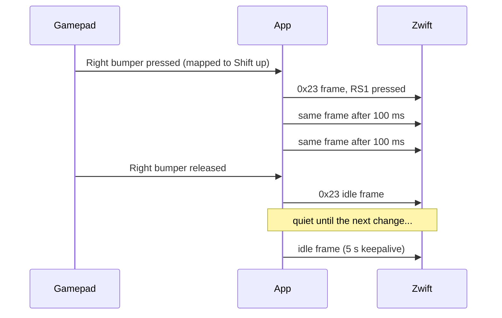

# Zwift controller protocol

!!! tldr "TL;DR"
    Zwift talks to a Zwift Ride through three characteristics: Zwift writes requests to `0003`, the device answers on `0004`, and button frames arrive on `0002`. The session starts with a "RideOn" handshake, then Zwift asks for device information, battery level and input configuration. After that the device sends `0x23` keypad frames: a protobuf message with an inverted 32-bit button bitmap and two analog paddle values. The app repeats frames every 100 ms while something is held and resends the current frame every 5 s as a keepalive.

Everything on this page travels inside Direct Connect writes and notifications. See [Wahoo Direct Connect](direct-connect.md) for the framing.

## Service and characteristics

| UUID | Name | Properties | Used for |
|---|---|---|---|
| `0xFC82` (`0000FC82-0000-1000-8000-00805F9B34FB`) | Zwift controls service | | Holds the three characteristics below. |
| `00000001-19CA-4651-86E5-FA29DCDD09D1` | Zwift service (128-bit) | | Holds the same three characteristics. |
| `00000002-19CA-4651-86E5-FA29DCDD09D1` | Async (`0002`) | Notify | Button frames and status messages, device to Zwift. |
| `00000003-19CA-4651-86E5-FA29DCDD09D1` | Sync RX (`0003`) | Write | Requests, Zwift to device. |
| `00000004-19CA-4651-86E5-FA29DCDD09D1` | Sync TX (`0004`) | Notify (indicate under the 128-bit service) | Replies, device to Zwift. |

Most messages start with a one-byte **opcode**, followed by a small [protobuf](glossary.md#protobuf) message.

## The RideOn handshake

Zwift writes the ASCII text `RideOn` followed by two bytes to `0003`. The app treats any write to `0003` that starts with `RideOn` and has at least two more bytes as the handshake.

| Step | Characteristic | Bytes | Meaning |
|---|---|---|---|
| Zwift writes | `0003` | `52 69 64 65 4F 6E 02 04` | `RideOn` + `02 04`. The last two bytes vary with the Zwift version. |
| App notifies | `0004` | `52 69 64 65 4F 6E 02 00` | `RideOn` + `02 00`. |
| App notifies | `0002` | `2A 08 03 12 0D 22 0B 52 49 44 45 5F 4F 4E 28 30 29 00` | A status message (opcode `0x2A`) holding the text `RIDE_ON(0)`. |

The app answers every RideOn, not only the first one. The first answered RideOn marks the session as connected.

!!! note "No encryption on this path"
    Bluetooth Zwift controllers can append a public key to the RideOn reply. Over Direct Connect, the app sends none and Zwift does not ask for one.

## Device information

After the handshake, Zwift writes **GET** requests to `0003`. A GET is opcode `0x00` followed by a protobuf message whose field 1 is a **data object id**. The app answers on `0004` with opcode `0x3C` (GET response): field 1 repeats the id, and field 2 holds the data.

| Request bytes | Data object id | What Zwift asks for | App reply |
|---|---|---|---|
| `00 08 00` | 0 (`0x000`) | Device information page | `3C 08 00 12 ...` (see below) |
| `00 08 10` | 16 (`0x010`) | Client/server configuration | `3C 08 10 12 02 08 00` |
| `00 08 80 08` | 1024 (`0x400`) | Controller input configuration | `3C 08 80 08 12 06 08 FF FF 03 10 03` |
| `00 08 83 06` | 771 (`0x303`) | Battery state | `3C 08 83 06 12 08 08 00 10 <percent> 18 00 20 00` |

Any other request on `0003` gets no reply. That matches the behaviour of the presentation Zwift is known to accept.

!!! tip "Decoding the request bytes"
    `00` is the opcode. `08` is the protobuf tag for field 1 as a varint. The rest is the id as a [varint](glossary.md#varint): `80 08` is 1024 and `83 06` is 771.

### Device information page

The reply to id 0 wraps a `DevInfoPage` message. The app sends these fields:

| Field | Name | Value | Notes |
|---|---|---|---|
| 1 | protocolVersion | 515 (`0x0203`) | |
| 2 | systemFwVersion | `00 00 01 01` | 4 raw bytes. |
| 3 | deviceName | `Zwift Ride` | |
| 6 | serialNumber | 15 characters | |
| 7 | systemHwRevision | `B.0` | |
| 8 | deviceCapabilities | deviceType 2, capabilities 1 | deviceType 2 is `USER_INPUT_DEVICE`. |
| 9 | manufacturerId | 1 | |
| 10 | productId | 8 | |
| 11 | deviceUid | 12 characters | |

The `deviceCapabilities` list is how a device tells Zwift what roles it plays. A pure controller claims only `USER_INPUT_DEVICE`. For comparison, see the [replies seen from other devices](additional-learnings.md#different-devices-describe-themselves-differently).

Here is a full reply with **synthetic** serial and id values:

```text
3C                      opcode 0x3C, GET response
08 00                   field 1: data object id 0
12 45                   field 2: 69 bytes of data
  0A 43                 DevInfo.field 1: DevInfoPage, 67 bytes
    08 83 04            protocolVersion 515
    12 04 00 00 01 01   systemFwVersion
    1A 0A 5A 77 69 66 74 20 52 69 64 65                         deviceName "Zwift Ride"
    32 0F 30 42 2D 30 31 32 33 34 35 36 37 38 39 41 42          serialNumber "0B-0123456789AB" (synthetic)
    3A 03 42 2E 30                                              systemHwRevision "B.0"
    42 04 08 02 10 01                                           deviceCapabilities {deviceType 2, capabilities 1}
    48 01                                                       manufacturerId 1
    50 08                                                       productId 8
    5A 0C 30 31 32 33 34 35 36 37 38 39 41 42                   deviceUid "0123456789AB" (synthetic)
```

### Controller input configuration

The reply to id 1024 says which inputs the controller has: field 1 = `0xFFFF` (supported digital inputs) and field 2 = `3` (supported analog inputs).

### Battery

The reply to id 771 (`0x303`) carries the battery percentage in field 2 of the inner message:

| Bytes | Meaning |
|---|---|
| `3C` | GET response |
| `08 83 06` | Data object id 771 |
| `12 08` | Field 2, 8 bytes follow |
| `08 00` | Inner field 1 = 0 |
| `10 46` | Inner field 2 = battery percent (here `0x46` = 70) |
| `18 00 20 00` | Inner fields 3 and 4 = 0 |

The app fills in the battery level of your game controller when Windows reports one. The SDL power levels map to percentages: empty 5, low 20, medium 70, full 100, wired 100. If the level is unknown, the app reports 100.

## Keypad frames

Button and paddle state goes to Zwift as notifications on `0002`. Each frame is opcode `0x23` followed by a `RideKeyPadStatus` protobuf message.

| Part | Protobuf | Content |
|---|---|---|
| Opcode | | `0x23` |
| Field 1 (tag `08`) | uint32 varint | Button bitmap, **inverted**: a pressed button clears its bit. |
| Field 3 (tag `1A`) | repeated message | One entry per analog paddle. |
| Entry field 1 (tag `08`) | varint | Location: `0` = left paddle (ZL), `1` = right paddle (ZR). |
| Entry field 2 (tag `10`) | sint32, [zigzag](glossary.md#zigzag-encoding) | Paddle value, -100 to 100. |

The bit for each button is listed in the [button reference](button-reference.md). With nothing pressed, every bit is set, so field 1 is `0xFFFFFFFF`, which encodes as the varint `FF FF FF FF 0F`.

The app always sends both paddle entries, even when they are 0.

### Paddles: steering and braking

| Paddle | Location | Steer (tilt outward) | Brake (squeeze inward) |
|---|---|---|---|
| ZL | 0 | Negative, down to -100 = full left | Positive, up to +100 |
| ZR | 1 | Positive, up to +100 = full right | Negative, down to -100 |

The app turns its steering value (-1 to 1) and brake value (0 to 1) into paddle values by multiplying by 100 and rounding. Braking uses both paddles at once. If steering and braking want the same paddle, the bigger value wins (steering wins a tie).

### Worked examples

**Idle, nothing pressed**

```text
23  08 FF FF FF FF 0F  1A 04 08 00 10 00  1A 04 08 01 10 00
    buttons: none      ZL = 0             ZR = 0
```

**Shift up** (RS1, mask `0x1000`). The bitmap is `~0x1000` = `0xFFFFEFFF`.

```text
23  08 FF DF FF FF 0F  1A 04 08 00 10 00  1A 04 08 01 10 00
    RS1 pressed        ZL = 0             ZR = 0
```

**Steer left, half way** (steer = -0.5, so ZL = -50, zigzag 99 = `0x63`).

```text
23  08 FF FF FF FF 0F  1A 04 08 00 10 63  1A 04 08 01 10 00
    buttons: none      ZL = -50           ZR = 0
```

**Brake, full** (brake = 1.0, so ZL = +100 and ZR = -100; zigzag 200 = `C8 01`, zigzag 199 = `C7 01`).

```text
23  08 FF FF FF FF 0F  1A 05 08 00 10 C8 01  1A 05 08 01 10 C7 01
    buttons: none      ZL = +100             ZR = -100
```

**The full Direct Connect message for "shift up"**, as it leaves the app:

```text
01 06 00 00 00 23                                  header: notification, seq 0, 35 bytes
00 00 00 02 19 CA 46 51 86 E5 FA 29 DC DD 09 D1    characteristic 0002
23 08 FF DF FF FF 0F 1A 04 08 00 10 00 1A 04 08 01 10 00
```

## Timing

| Rule | Value | Why |
|---|---|---|
| Controller polling | every 25 ms | The app reads the gamepad. |
| Send on change | at once | A new frame goes out as soon as the button or paddle state changes. |
| Repeat while active | every 100 ms | While any button is held or a paddle is not 0, the frame is resent. |
| Release | one neutral frame | When everything is released, the app sends one idle frame and then stops repeating. |
| Keepalive | every 5 s | The current frame (usually idle) is resent while Zwift is connected, as a real Zwift Ride does. Without traffic, controllers can be dropped after about 30 s. |
| Disconnect | reset to neutral | When Zwift disconnects, the stored state is reset so nothing is "stuck" on reconnect. |


