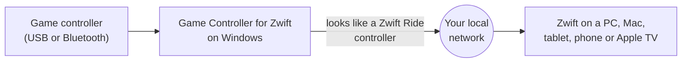

# Game Controller for Zwift

Game Controller for Zwift lets you ride Zwift with a video game controller you already own. Plug in an Xbox controller, a pair of Joy-Cons or another popular gamepad, and use it to shift, steer, brake and move through Zwift's menus.

The app runs on Windows. It shows up in Zwift as a controller called **Voltage Gamepad**, so you pair it in Zwift just like any other controller. No extra hardware, no keyboard tricks and no Bluetooth pairing with Zwift.

## Who this site is for

- **Riders** who want to use the app. Start with [Install and first run](use/install.md).
- **Protocol implementers** who want to build a Zwift controller bridge in any language. Start with [The big picture](how-it-works/big-picture.md).
- **Developers** who want to build the app or contribute. Start with [Architecture](build/architecture.md).

## How it fits together

The app and Zwift can run on the **same computer**, or on **different devices** that share the same local network. For example, the app can run on a Windows laptop next to your bike while Zwift runs on an Apple TV.

## What you can do

- Shift gears up and down (or change the intensity during a workout).
- Steer and brake, with partial steering and braking from analog sticks and triggers.
- Navigate Zwift's menus, select, go back, use power-ups and give Ride Ons.

Ready? Head to [Install and first run](use/install.md).
