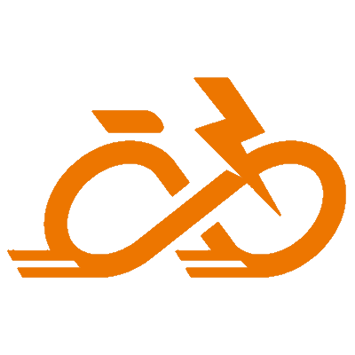

# Game Controller for Zwift

The goal of this project is to enable using standard Game Controllers to interact with Zwift, much like the capabilities of the Zwift Play Controllers or the Wahoo Kickr Bike Shift.

## Project Organization

This project's organization loosely follows a Clean Architecture Layout.

### Domain

`GameControllerForZwift.Core` defines base entities and interfaces for the other projects to use.

### Application

`GameControllerForZwift.Logic` is the main functionality of the application. This has turned out to be simple enough that I will combine the Domain and Application projects in the future.

### Infrastructure

`GameControllerForZwift.Gamepad` leverages SDL2 to capture game controller input.

`GameControllerForZwift.Network` emulates a Zwift Ride controller over the local network (Wahoo DirCon over WiFi/LAN plus mDNS), which is how Zwift receives shifting, steering, braking and menu input. Keyboard emulation has been removed.

### Presentation

`GameControllerForZwift.UI.WPF` contains ViewModels and any custom controls.

`GameControllerForZwift.WPF` is a WPF executable application.
