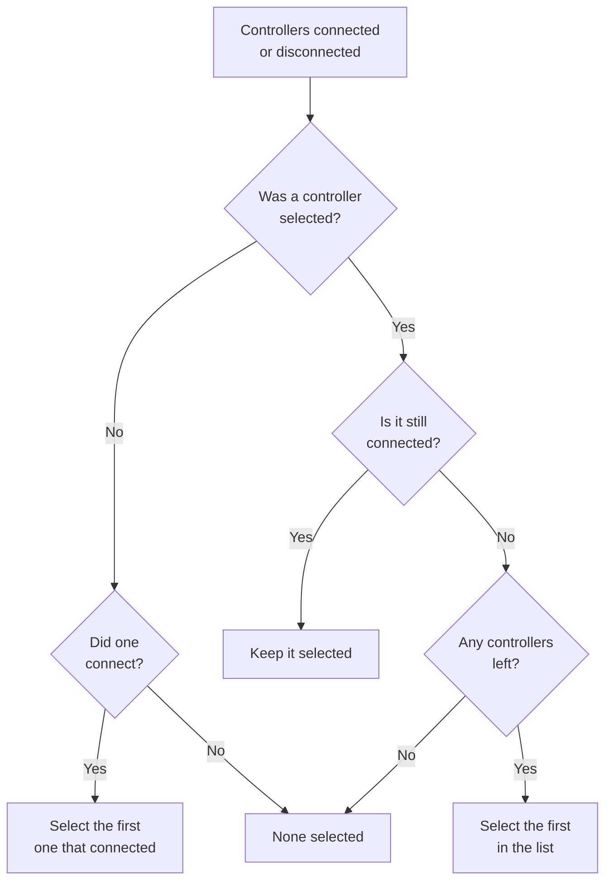

# Controller detection

!!! tldr "TL;DR"
    The controller list on the Controller Setup page updates by itself. When you connect or disconnect a controller, the list changes within about half a second. There is no Refresh button. The controller you picked stays selected while other controllers come and go. If it disconnects, the app picks the next one. If none are left, the list shows "None selected".

## How to read this spec

Every rule has a stable ID (`CTRL-001` and up), so tests, issues and other specs can point to it. **must**, **should** and **may** mean the same as in the [saved configurations spec](saved-configurations.md#how-to-read-this-spec).

## Terms

- **Connected controller:** a device that SDL reports and has a game controller mapping for. Plain joysticks without a mapping are not listed.
- **Selected controller:** the one in the controller drop-down. The app reads input from it and sends it to Zwift.
- **Controller model:** vendor and product ID, as in the [saved configurations spec](saved-configurations.md#terms).

## The controller list

Every controller you connect gets its own entry, even two of the same model. The list keeps the order in which controllers connected, and a new one goes at the end.

*Example: you connect an Xbox Series X controller, then an 8BitDo SN30 Pro+. The list shows "Xbox Series X Controller" and then "Xbox One S Controller", because that is how the 8BitDo identifies itself.*

| Rule | ID |
|---|---|
| Every connected controller is listed, one entry per controller, including two controllers of the same model. A left and right Joy-Con pair that SDL combines counts as one controller. | CTRL-001 |
| The app checks for controllers that connected or disconnected about every 500 ms and updates the list without a Refresh button. | CTRL-002 |
| The app only opens controllers that connected and only closes controllers that disconnected. A controller that stays connected keeps its entry and its connection, and a check that finds no change does nothing. | CTRL-003 |
| A controller that connects is added at the end of the list. The others keep their place. | CTRL-009 |

??? note "Edge cases"
    - The app tells controllers apart by the SDL instance id of the connection, not by name or model. Two identical controllers are two entries with the same name.
    - A controller that disconnects and connects again is a new connection, so it goes to the end of the list.
    - The check runs on the UI thread, which also owns SDL. The app logs controllers only when the set of devices changes, so the log does not grow while nothing happens.

## Selection

The app keeps your choice. Connecting or disconnecting another controller never changes which one is selected. Only when the selected controller goes away does the app choose for you.

*Example: you ride with the Xbox controller selected. A friend turns on a second controller. Your Xbox controller stays selected. Then your Xbox controller's battery dies, so the app selects your friend's controller, the next one in the list. When your Xbox controller comes back, your friend's controller stays selected until you switch.*

| Rule | ID |
|---|---|
| The selected controller stays selected while other controllers connect or disconnect. | CTRL-004 |
| If the selected controller disconnects and other controllers are still connected, the app selects the first controller in the list. | CTRL-005 |
| If the selected controller disconnects and no controllers remain, the list is empty and shows "None selected". The configuration bar shows only Default, and Save as and Import are disabled (CFG-020, CFG-037). | CTRL-006 |
| When a controller connects and nothing is selected, the app selects it. When a controller connects while another is selected, the selection stays. A returning controller does not take the selection back. | CTRL-007 |
| A switch the app makes on its own follows CFG-024: with unsaved changes it asks Save, Don't save or Cancel. Cancel keeps your edits and their configuration list on screen, with no controller selected. | CTRL-008 |

??? note "Edge cases"
    - A switch to a controller of the same model keeps the configuration and any unsaved edits, because the configurations do not change. The app does not ask.
    - A switch to another model opens that model's last-used configuration (CFG-017).
    - When the last controller disconnects and you have unsaved edits, the app asks first. Cancel keeps the configuration bar of the disconnected controller, so you can still use Save as.
    - When the controller comes back after the list was empty, it is selected and its last-used configuration opens.

## Controllers that identify as another model

Some third-party controllers present themselves to Windows as an Xbox controller. The app lists the name and model that SDL reports, so these controllers show up under the Xbox name.

*Example: an 8BitDo SN30 Pro+ in X-input mode reports as an "Xbox One S Controller" (vendor 045E, product 02E0). It shares the saved configurations of a real Xbox One S controller.*

| Rule | ID |
|---|---|
| A controller is listed with the name and model SDL reports. A third-party controller that identifies as an Xbox controller is treated as that Xbox model, and shares that model's configurations (CFG-011). | CTRL-010 |

??? note "Edge cases"
    - The same 8BitDo controller in another mode (for example Switch mode) reports a different model, so it has its own configurations.
    - Two controllers that report the same model are still two entries in the list (CTRL-001).

## Out of scope

- Choosing more than one controller at a time. The app reads one controller.
- Remembering which physical controller was selected between app starts. At start the app selects the first connected controller.
