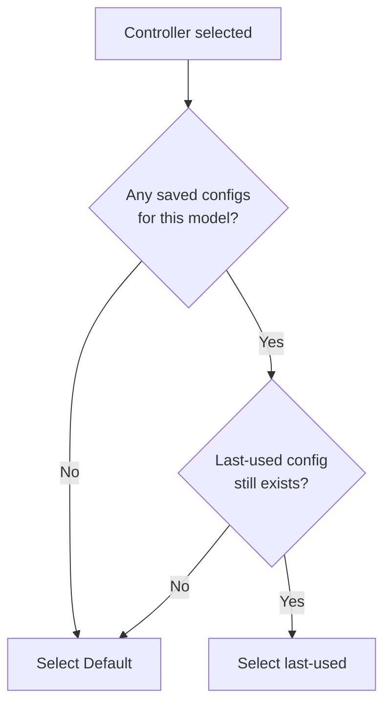
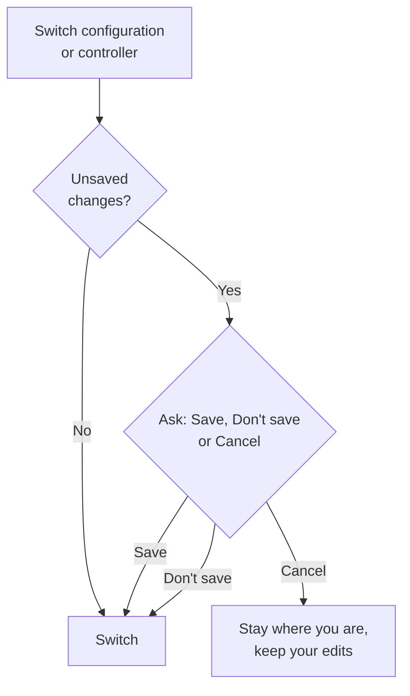
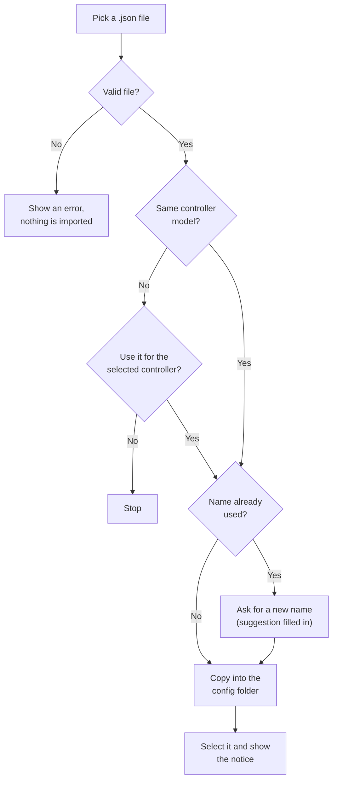

# Saved controller configurations

!!! tldr "TL;DR"
    You can save, reload, rename, delete, import and share controller configurations (button mappings). Each configuration is one JSON file in a per-user folder. A configuration belongs to a controller *model* (vendor and product ID), so a second controller of the same model shares it. The built-in Default is always available and read-only.

## How to read this spec

Every rule has a stable ID (`CFG-001` and up), so tests, issues and other specs can point to it. In the rules, three words have a fixed meaning:

- **must** means the rule is required.
- **should** means the rule is expected unless there is a good reason to do otherwise.
- **may** means the rule is optional.

## Terms

- **Configuration (config):** a named set of input mappings for one controller model. The code calls this a `ControllerProfile`.
- **Controller model:** identified by USB vendor ID (VID) and product ID (PID) as reported by SDL. Not the serial number or the per-device instance ID.
- **Default:** the built-in configuration shipped with the app (`defaultprofile.json`).
- **Config folder:** `%LOCALAPPDATA%\GameControllerForZwift\Profiles\`.
- **App data folder:** `%LOCALAPPDATA%\GameControllerForZwift\` (also holds `settings.json`).

## Storage

Each configuration you save becomes one small JSON file in your config folder. The app creates the folder the first time you save. If you add, change or remove files there yourself, the app notices and updates its list.

*Example: you save "Climbing" for your Xbox controller. A file named `Xbox-Series-X-Controller_Climbing.json` appears in the config folder. You can copy it to a USB stick or email it to a friend.*

| Rule | ID |
|---|---|
| Each saved configuration is stored as its own JSON file in the config folder. | CFG-001 |
| The app creates the config folder on first save if it does not exist. | CFG-002 |
| The file holds everything needed to load it. The filename is for humans only, and loading never depends on it. | CFG-003 |
| Filenames should be `<ControllerName>_<ConfigName>.json`. Characters that are invalid in Windows filenames and whitespace are replaced by `-`. If the name is taken on disk, the app appends `-2`, `-3`, and so on. | CFG-004 |
| A file that fails to parse is skipped with a log warning. It never crashes the app and is never deleted. | CFG-005 |
| The app should watch the config folder and refresh its lists when files are added, changed or removed outside the app. | CFG-006 |

??? note "Edge cases"
    - Any run of whitespace, control characters or invalid characters (`< > : " / \ | ? *`) becomes a single `-`. Trailing dots are dropped, because Windows would drop them anyway.
    - If a part of the name ends up empty, the app uses `Controller` or `Configuration` in its place.
    - The controller part of the filename is cut to 60 characters.
    - A rename that only changes the case of the name keeps the same file.
    - The app writes the new file before it removes the old one when renaming, so a failure never loses a configuration.
    - If two files share the same `id` (for example a copy made in File Explorer), the app lists the first one (by filename) and skips the other with a log warning. Selection is by `id`, so two entries would be ambiguous.
    - The folder watcher waits 400 ms after the last file event before it refreshes, so a burst of changes causes one refresh.
    - Unsaved edits on screen survive a refresh that comes from the folder.

### File format (version 1)

Each file is plain JSON. This is a complete example:

```json
{
  "formatVersion": 1,
  "id": "6f1c2b9e-1d2a-4f2e-9a51-3c0d7c1b2a10",
  "name": "Climbing",
  "controller": {
    "vendorId": "045E",
    "productId": "0B13",
    "name": "Xbox Series X Controller"
  },
  "mappings": [
    { "input": "RightShoulder", "function": "ShiftUp" },
    { "input": "LeftShoulder", "function": "ShiftDown" }
  ],
  "modified": "2026-11-16T21:15:00Z"
}
```

The file says which controller model it is for, which input does what, and when it last changed. The file carries a format version. The app refuses a file with a version newer than it understands.

*Example: a friend with a newer version of the app sends you a file with `formatVersion` 2. Your app refuses it and tells you to update, instead of guessing.*

| Rule | ID |
|---|---|
| `formatVersion` must be present. The app refuses, with a clear message, any file with a higher version than it understands. | CFG-007 |
| `id` is a GUID assigned on creation. It identifies a configuration across renames and refreshes. | CFG-008 |
| `input` and `function` use the existing enum names (`ControllerInput`, `ZwiftFunction`). An unknown value loads as `None`, which matches today's JSON converters. | CFG-009 |
| Inputs missing from `mappings` load as `None`. | CFG-010 |

??? note "Edge cases"
    - A file is also rejected, with a message that names the problem, if it is empty, is not valid JSON, or has no `id`, `name` or `controller`.
    - A mapping entry with an unknown `input` is skipped, which has the same effect as `None`. An unknown `function` loads as `None`.
    - The `vendorId` and `productId` are hexadecimal text, with or without a `0x` prefix. If one cannot be read, it is treated as unknown (0000), and matching falls back to the controller name (CFG-014).
    - The app writes `mappings` sorted by input, and `modified` in UTC to the second.
    - The reader accepts comments and trailing commas, and property names in any case. The writer uses camelCase.

## Controller identity

A configuration belongs to a *model* of controller, not to one physical unit. You can unplug your Xbox controller, plug in a different one of the same model, and see the same configurations.

*Example: you have two identical controllers, one for you and one for a friend who rides with you. Both show the same saved configurations.*

| Rule | ID |
|---|---|
| A configuration is associated with a controller model by VID and PID, not by serial number or device instance. | CFG-011 |
| When a controller connects, the app lists every configuration whose VID and PID match, regardless of which physical unit saved it. | CFG-012 |
| The app should support an alias list of VID/PID pairs that are the same model (for example a controller that reports a different PID over USB and Bluetooth). The list starts empty, and I add entries as real cases appear. | CFG-013 |
| When SDL reports no VID or PID (0000), the app falls back to the controller name for matching. | CFG-014 |

??? note "Edge cases"
    - The name fallback ignores case and surrounding whitespace.
    - Last-used is also keyed by the model, using the same alias rules. Aliased models share one last-used entry.

## Selecting a configuration

When you pick a controller, the app shows Default first and then your saved configurations, alphabetically. It opens the one you used last on that model of controller. If you've never saved one, or the last one was deleted, it opens Default.

*Example: you saved "Climbing" on your Xbox controller yesterday. Today you plug in a second Xbox controller of the same model, and "Climbing" is already selected.*

| Rule | ID |
|---|---|
| Default is listed first, then saved configs sorted by name (ignoring case). Configurations of other controllers follow when CFG-039 is on. | CFG-015 |
| The last-used config for that controller model is selected. | CFG-017 |
| If there's nothing saved, or the last-used one is gone, Default is selected. | CFG-016, 018 |
| After any save, rename, delete or import, the list refreshes and your selection stays put. | CFG-019 |



??? note "Edge cases"
    - Last-used is stored in `settings.json` by configuration `id`, one entry per controller model.
    - The app records last-used when you switch configurations, save, save as and import. Selecting Default clears the entry, and so does deleting the selected config.
    - The refresh in CFG-019 also covers save as, folder changes and import. Matching is by `id`. If the selected config was deleted, Default is selected.
    - If two saved configs have the same name ignoring case (for example from files copied in by hand), the app sorts them by `id` after the name so the order is stable.
    - Edits you have not saved stay on screen when the list refreshes because of a folder change. They are not replaced by the file's contents.

### Configurations from other controllers

Under the drop-down sits a checkbox, **Show configurations from other controllers**. When you check it, the list also shows the configurations you saved for other controller models, after your own. Picking one asks whether to use it with this controller. If you agree, the app saves a copy for this controller and selects the copy.

*Example: you saved "Climbing" for your Xbox Series X controller. Today you ride with a DualSense. You check the box, and the list reads:*

```
Default
SRAM Style
Shimano Style
Climbing (Xbox Series X Controller)
```

*You pick "Climbing (Xbox Series X Controller)" and answer Use it. A new "Climbing" for the DualSense appears and is selected. The Xbox controller keeps its own "Climbing".*

| Rule | ID |
|---|---|
| A checkbox **Show configurations from other controllers** is unchecked by default and its state is kept in `settings.json`. When it is checked, the list shows, after this controller's entries, the saved configurations of other controller models, sorted by name (ignoring case), each followed by its controller name in parentheses. | CFG-039 |
| Selecting a configuration of another controller asks "Use Climbing with this controller?". On yes, the app saves a copy for the selected controller model with a new `id` and selects it. On no, the previous selection stays. | CFG-040 |
| The original configuration stays with its own controller model and is not changed. | CFG-041 |
| If the copy's name is already used for this controller, the app asks for a new name as in CFG-032. With unsaved changes, the app asks Save, Don't save or Cancel (CFG-024) before it switches. Cancel in either prompt saves nothing and keeps the previous selection. | CFG-042 |

??? note "Edge cases"
    - Two configurations of other controllers with the same name are sorted by controller name, then by `id`.
    - A configuration of another controller is never the last-used one. The copy is, once you select it.
    - After the copy is saved, the app shows the notice "Saved a copy to your configurations." (CFG-031).
    - Name checks for Save as, Rename and Import only look at this controller's configurations (CFG-027). Entries of other controllers do not block a name.
    - With no controller selected (CTRL-006), the list shows only Default, even when the box is checked.
    - A controller model in the alias list (CFG-013) counts as the same model, so its configurations are listed as this controller's own.

## Editing and saving

You can change the mappings at any time. A dot after the name (for example `Climbing •`) means there are changes you have not saved. Save overwrites the selected configuration. Save as makes a new one. You can never overwrite Default.

*Example: you start from Default, swap two buttons and press Save as. You name it "Climbing". Default is untouched, and "Climbing" is now selected.*

| Rule | ID |
|---|---|
| Default is read-only. It cannot be overwritten, renamed or deleted. You may edit mappings while Default is selected, and then only **Save as** is enabled. | CFG-020 |
| When the current mappings differ from the selected configuration as saved, the UI shows an unsaved-changes indicator (for example `Climbing •`). | CFG-021 |
| **Save** overwrites the selected configuration's file and updates `modified`. | CFG-022 |
| **Save as** asks for a name, creates a new configuration with a new `id`, then selects it. | CFG-023 |
| Switching configuration or controller with unsaved changes asks you to Save, Discard or Cancel. | CFG-024 |
| **Rename** changes `name`, renames the file as in CFG-004, and keeps the same `id`. | CFG-025 |



??? note "Edge cases"
    - Choosing Save in the prompt while Default is selected opens the Save as dialog. If you cancel that dialog, the switch is cancelled too.
    - The prompt's buttons read Save, Don't save and Cancel. Don't save is the Discard choice.
    - Save as suggests a name based on the selected configuration (for example `Climbing (2)`). It suggests nothing when Default is selected.
    - Save as is enabled whenever a controller is selected, even when a saved configuration is selected. Save is enabled only for a saved configuration with unsaved changes.
    - Rename keeps your on-screen mappings, including unsaved edits, and updates `modified`. A rename to the exact same name does nothing.
    - A failed save, rename or delete shows an error message and leaves the list as it was.
    - Deleting a configuration discards any unsaved edits to it after you confirm the delete.

## Names

Every configuration needs a name that is short, not blank, and different from the others for that controller. The name box tells you right away if a name will not work, so you never lose work to a silent overwrite.

*Example: you already have "Climbing". You type "climbing " with a different case and a trailing space. The box shows "A configuration named 'Climbing' already exists for this controller" and the Save button stays disabled.*

| Rule | ID |
|---|---|
| Names are 1 to 50 characters after trimming leading and trailing whitespace. | CFG-026 |
| Names are unique per controller model, compared ignoring case and after trimming. `Default` is reserved. | CFG-027 |
| The name field validates as you type. It shows an inline message ("A configuration named 'Climbing' already exists for this controller") and disables the confirm button until the name is valid. Duplicates are blocked and never silently overwritten. | CFG-028 |

??? note "Edge cases"
    - The other messages are "Enter a name.", "Use 50 characters or fewer." and "'Default' is reserved for the built-in configuration."
    - An empty box disables the confirm button but shows no message until you type something.
    - When you rename, your own current name does not count as a duplicate.
    - Names are unique per model, so the same name may exist for two different controller models.

## Delete

Delete removes the selected configuration after you confirm. The app then goes back to Default.

*Example: you press Delete on "Climbing" and confirm. The file is gone, and Default is selected.*

| Rule | ID |
|---|---|
| **Delete** asks for confirmation, then deletes the file and selects Default. | CFG-029 |

??? note "Edge cases"
    - The confirmation reads "Delete 'Climbing'? This can't be undone."
    - Delete is disabled while Default is selected.
    - Deleting also clears the last-used entry for that controller model.

## Import and sharing

To share a configuration, copy its file. To use one someone sent you, pick it with Import. The app checks the file, makes its own copy in your config folder and selects it.

*Example: a friend emails you `Climbing.json`. You choose Import, pick the file, and see "Saved a copy to your configurations." Your friend's file stays where it was.*

| Rule | ID |
|---|---|
| **Import** opens a file picker for `.json` files, validates the file (CFG-005, CFG-007), copies it into the config folder and selects it. | CFG-030 |
| After a successful import the app shows a non-blocking notice: "Saved a copy to your configurations." | CFG-031 |
| If the imported name collides (CFG-027), the app asks for a new name, pre-filled with a suggestion such as `Climbing (2)`. | CFG-032 |
| If the imported file's controller model does not match the selected controller, the app asks whether to use it for the selected controller. If you say yes, it rewrites `controller` to the selected model and assigns a new `id`. | CFG-033 |
| An **Open folder** button opens the config folder in File Explorer, creating it first if needed. Sharing is done by copying files from there. | CFG-034 |



??? note "Edge cases"
    - The notice goes away on its own after 6 seconds, or when you dismiss it.
    - If the file's `id` is already in use in the config folder (for example you import a file from the folder itself), the copy gets a new `id`.
    - A file that cannot be imported (not valid JSON, missing fields, or a newer format version) shows an error message that says why.
    - If there are unsaved changes, the app asks Save, Don't save or Cancel before the import is selected (CFG-024).
    - Cancelling the rename prompt cancels the import.
    - The picker is disabled when no controller is selected.

## Settings

Settings has one action for this feature: delete every saved configuration at once. It asks first, and tells you how many files it will remove.

*Example: you press Delete all in Settings. The dialog says "Delete all 3 saved configuration files? This cannot be undone." After you confirm, every controller is back on Default.*

| Rule | ID |
|---|---|
| Settings offers **Delete all saved configurations**, behind a confirmation dialog that states how many files will be deleted and that this cannot be undone. | CFG-035 |
| After deleting all, every controller falls back to Default and the last-used entries are cleared. | CFG-036 |

??? note "Edge cases"
    - If there is nothing to delete, the app says so and does not ask for confirmation.
    - The dialog also says that Default stays.
    - If one file cannot be deleted (for example it is open in another program), the app logs it and deletes the rest.
    - Controller Setup falls back to Default as soon as the files are gone.

## UI layout (Controller Setup page)

A configuration bar sits above the mapping grid. The drop-down picks the configuration. The buttons act on it. The `...` button opens a menu with the less common actions.

```
[ Climbing •          v ]  [Save] [Save as...] [Delete]  [...]
[ ] Show configurations from other controllers            Import...
                                                          Rename...
                                                          Open folder
```

| Rule | ID |
|---|---|
| Buttons that do not apply are disabled, not hidden (Save and Delete on Default, Save when nothing changed). | CFG-037 |
| All dialogs are usable with a game controller and keyboard as well as a mouse. | CFG-038 |

??? note "Edge cases"
    - Rename is in the `...` menu and is also disabled on Default.
    - Disabled buttons still show their tooltip.
    - With a game controller, the D-pad moves focus (up and left go back, down and right go forward), A presses the focused button, and B cancels.

## Out of scope

- Syncing configurations between machines (you copy files).
- Per-configuration deadzones or curves (deadzones are global).
- Sharing configurations online.
- Log files. They are not stored in the app data folder.
