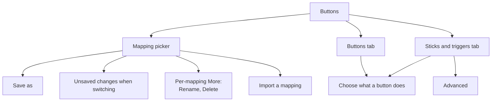

# Buttons screens

!!! tldr "TL;DR"
    The Buttons tab is where you choose what each input on your controller does. A mapping picker, Save, and Save as new sit at the top. Two tabs below split buttons from sticks and triggers. A controller illustration and a list say the same thing in two ways. Tapping or clicking a row opens a picker of Zwift functions, grouped by what they do. Saving and switching mappings follow the saved configurations spec by ID.

In the rules, "must", "should", and "may" have the meaning given in [how to read a spec](../index.md). A **mapping** is what the saved configurations spec (`CFG`) calls a configuration.

## The Buttons screen

**What it is for:** see and change what every input does.

**Content, top to bottom:** the mapping picker (`ButtonsMappingPicker`, for example "Mapping: Climbing, unsaved changes"), **Save** and **Save as new** (`ButtonsSaveButton`, `ButtonsSaveAsButton`), two tabs (Buttons, and Sticks and triggers), the controller illustration (`ButtonsControllerImage`), and the list of what each input does (`ButtonsRow_{input}`, for example "Right bumper: shift up").

The screen's hint says: "Press a button on your controller to see it light up. Tap a row to change what it does."

*Example: you press X on your controller. The X row lights up while you hold it, and nothing else changes. X is a free button, so the row says "No action". You click the row, and the picker opens. You close it, and the row is no longer selected.*

| Rule | ID |
|---|---|
| The screen must have a mapping picker, Save and Save as new, a Buttons tab, a Sticks and triggers tab, the controller illustration, and a list of what each input does. | SCR-BTN-001 |
| The list must carry the same information as the illustration, in text. | SCR-BTN-002 |
| Each list row must say the input and its function, for example "Right bumper: shift up". A button with no function must say "No action". | SCR-BTN-003 |
| The illustration must show the selected button, mark free keys with a dashed outline, and use the lit style for a press (see [Visual system](../ux/visual-system.md)). | SCR-BTN-004 |
| Tapping or clicking a row must select it and open the function picker. A controller press must not open the picker. | SCR-BTN-005 |
| A controller press here must only light the matching row, so you can test your controller. It must not select a row, open the picker, navigate, save, or go back. | SCR-BTN-006 |
| The screen must show the hint "Press a button on your controller to see it light up. Tap a row to change what it does." and no controller hint bar. | SCR-BTN-007 |
| The Save button is the screen's one main action, and it must be an accent button only when it is enabled (that is, when a saved mapping has unsaved changes, see `CFG-037`). | SCR-BTN-008 |
| The screen must have a **Reset to default** action for the current mapping's mappings. | SCR-BTN-009 |
| The Buttons screen must stay visual: the illustration first, the list as the text version. | SCR-BTN-010 |
| The illustration must match the selected controller's kind (CTRL-011 and UX-V-059). When the kind changes because you select another controller, the illustration changes with it. | SCR-BTN-046 |
| The accessible name of `ButtonsControllerImage` must include the kind, for example "Your Xbox controller". | SCR-BTN-047 |
| The illustration must show only the inputs the kind has, and the list must list only those inputs. | SCR-BTN-048 |
| A row stays selected only while its function picker is open. When the picker closes, by any means, no row is selected. A row then looks selected only while you hold its button, so you can test your controller. | SCR-BTN-044 |
| On Windows, the function picker is a side panel. On Android and iOS, it must be a bottom sheet built with the platform's native bottom sheet component, not a custom one. | SCR-BTN-045 |

??? note "Edge cases"
    - The Buttons header has no More menu of its own. Advanced options have their own place at the bottom of Sticks and triggers.
    - With no controller, the screen shows the same "Wake your controller" state as Ride.

## Mappings

A mapping is a named set of mappings for one controller model. The behavior, storage, and rules live in the saved configurations spec. This section says where each part appears on screen, and refers to the spec for the rule.

### Mapping picker

Default is listed first and is locked. Saved mappings follow, sorted by name. The selected one shows **Unsaved changes** in words when it has edits. The picker also offers **Import a mapping** and, per mapping, a More menu (Rename, Delete). On a phone it offers **Share**. On desktop it offers **Open folder**.

| Rule | ID |
|---|---|
| The picker must list Default first, then saved mappings by name, and select the last-used one. See `CFG-015` to `CFG-019`. | SCR-BTN-011 |
| Default must show as locked. It cannot be overwritten, renamed, or deleted. See `CFG-020`. | SCR-BTN-012 |
| The selected mapping must show "Unsaved changes" in words when its mappings differ from what is saved. See `CFG-021`. | SCR-BTN-013 |
| The app must disable buttons that do not apply instead of hiding them. See `CFG-037`. | SCR-BTN-014 |
| The picker must offer **Import a mapping**. See `CFG-030`. | SCR-BTN-015 |
| On desktop the picker must offer **Open folder**. See `CFG-034`. | SCR-BTN-016 |
| On phone the picker must offer **Share** in its place. Sharing a mapping hands the mapping's file to the system share sheet. | SCR-BTN-017 |
| Each saved mapping must have a More menu with Rename and Delete. Default's More menu must have neither enabled. See `CFG-020`, `CFG-025`, and `CFG-029`. | SCR-BTN-018 |

### Save and Save as

| Rule | ID |
|---|---|
| **Save** must overwrite the selected mapping. See `CFG-022`. | SCR-BTN-019 |
| **Save as new** must ask for a name and select the new mapping. See `CFG-023`. | SCR-BTN-020 |
| The name field must check the name as you type and disable Save until the name is valid. See `CFG-026` to `CFG-028`. | SCR-BTN-021 |
| When a name is already used, the message should read "You already have a mapping called Climbing. Try another name." | SCR-BTN-022 |

*Example: you type "climbing" and already have "Climbing". The field says "You already have a mapping called Climbing. Try another name." and Save stays disabled.*

### Unsaved changes when switching

| Rule | ID |
|---|---|
| Switching mapping or controller with unsaved changes must ask what to do. See `CFG-024`. | SCR-BTN-023 |
| The dialog's choices should read **Save and switch**, **Switch without saving**, and **Cancel**. | SCR-BTN-024 |

### Rename, delete, and import

| Rule | ID |
|---|---|
| **Rename mapping** must open a dialog with the current name filled in and focused, a 50-character limit, and Cancel and Rename. See `CFG-025` and `CFG-026`. | SCR-BTN-026 |
| **Delete** must say the file is deleted and that it can't be undone, and must say the controller then switches to Default. See `CFG-029`. | SCR-BTN-027 |
| Importing a mapping made for a different controller must ask whether to use it with this controller. See `CFG-033`. | SCR-BTN-028 |
| Importing a mapping whose name is used must ask for a new name, filled in with a suggestion such as "Climbing (2)". See `CFG-032`. | SCR-BTN-029 |
| After a successful import the app must show "Saved a copy to your mappings." with an Undo. See `CFG-031`. | SCR-BTN-030 |
| Settings must offer **Delete all saved mappings**, stating the count and that it can't be undone. See `CFG-035` and [Settings](settings.md). | SCR-BTN-031 |

??? note "Edge cases"
    - The saved configurations spec describes the notice and the dialog buttons in its own words ("configuration", "Don't save"). The words in this page are the UI words and are used in the app.
    - The saved configurations spec describes a bar of buttons above the mapping grid (`CFG` "UI layout"). The screens here replace that arrangement with the picker, Save, and the per-mapping More menu. The rules `CFG-037` and `CFG-038` still apply.
    - The Import file picker is the standard system file picker. It works with a mouse and keyboard.

## Choose what a button does

**What it is for:** pick a Zwift function for the selected input.

It opens as a sheet on a phone, and as a side panel on a landscape screen. Functions are grouped by what they do and use Zwift Ride names. Hold hints and a brake caution sit next to the ones that need them.

| Group | Functions |
|---|---|
| **Riding** | Shift up (harder gear), Shift down (easier gear), Steer left, Steer right, Brake |
| **Zwift buttons** | Ride On, Power-up |
| **Menus** | Navigate up, Navigate down, Navigate left, Navigate right, Select, Back |
| **This app** | Functions that are the app's own. The group has none today, so the picker leaves it out. |
| **Nothing** | No action |

| Hint | Where |
|---|---|
| "In a ride, opens the action bar" | Navigate up |
| "In a ride, makes a U-turn" | Navigate down |
| "Hold to send Ride Ons to nearby riders (Zwift's behavior)" | Ride On |
| "Hold to skip a workout block (Zwift's behavior)" | Power-up |
| "Even a light squeeze can stop you" | Brake |

| Rule | ID |
|---|---|
| The picker must show functions in the groups Riding, Zwift buttons, Menus, This app, and Nothing, in that order. | SCR-BTN-032 |
| Functions must use the real Zwift Ride names. The picker must not list invented functions such as "U-turn" or "Camera view". | SCR-BTN-033 |
| Each function must be a radio choice (`FunctionItem_{function}`) with one short line saying what it does, such as "Shift up, harder gear". | SCR-BTN-034 |
| Navigate up, Navigate down, Ride On, and Power-up must show their hint. | SCR-BTN-035 |
| **This app** must list only functions the app really implements, and must not show them as Zwift functions. When the app implements none, the picker must leave the group out. | SCR-BTN-036 |
| The sheet or panel must trap focus, and Esc must close it. See [Accessibility](../ux/accessibility.md). | SCR-BTN-037 |
| Choosing a function must apply right away to the current mapping and show "Unsaved changes". | SCR-BTN-038 |

??? note "Edge cases"
    - Shift up in a workout raises the intensity, and shift down lowers it.
    - A hold on a mapped button reaches Zwift as a hold, so Zwift's own hold actions work. The hint explains the hold.

## Sticks and triggers

**What it is for:** show analog inputs live and let you map each direction.

Sticks and triggers are analog. A small tilt steers a little. A light squeeze brakes a little. The tab lists the same kind of rows as the Buttons tab, in the same two columns that reflow with the window: the left side down the first column and the right side down the second. Each side has its trigger, its stick click, and one row per direction. The controller illustration shows where each stick is. A trigger's row shows how far it is pulled.

| Rule | ID |
|---|---|
| The controller illustration must show each stick's live position (UX-V-060). The tab must not draw a separate stick graph. | SCR-BTN-039 |
| The tab must list its rows like the Buttons tab, one row per input in the same columns. In order, the rows are the trigger, the stick click, and the stick up, down, left, and right, with the left side in the first column and the right side in the second. The tab must not group rows in cards. | SCR-BTN-040 |
| A trigger's row must fill its chip with the accent from left to right in proportion to the pull, from 0 to 100 percent, with the label staying readable. A pulled trigger must not light its whole chip. | SCR-BTN-041 |
| The brake caution, "Even a light squeeze can stop you.", must appear with the Brake function in the function picker. | SCR-BTN-042 |
| **Advanced** (dead zones and curves) must be a section at the bottom of this tab. | SCR-BTN-043 |

??? note "Edge cases"
    Per-mapping dead zones or curves are out of scope in the saved configurations spec. Dead zones are global.

## Controller input on these screens

A controller press lights the matching row. Dialogs work with touch, mouse, and keyboard. See [Controller input](../ux/controller-input.md).

## Accessibility IDs

| ID | Where |
|---|---|
| `ButtonsMappingPicker`, `ButtonsSaveButton`, `ButtonsSaveAsButton` | Top of the screen |
| `ButtonsRow_{input}` | List rows |
| `ButtonsControllerImage` | Illustration. Its name includes the controller kind, for example "Your Xbox controller". |
| `FunctionItem_{function}` | Function picker |
| `MappingItem_{id}` | A saved mapping in the picker (the mapping's GUID) |
| `MessageDialogPrimaryButton`, `MessageDialogSecondaryButton`, `MessageDialogCloseButton` | Message dialogs |
