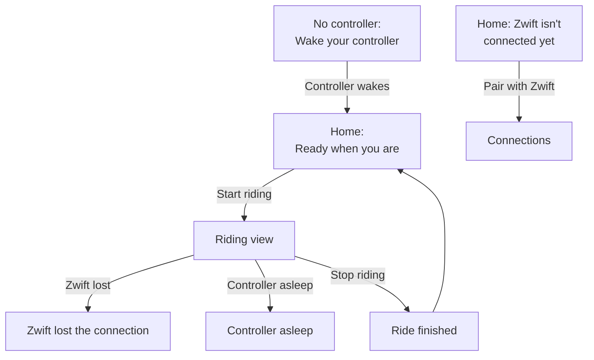

# Ride screens

!!! tldr "TL;DR"
    Ride is the home tab. It shows your controller, honest stats, your layout and whether Zwift can see you. The one main action is **Start riding**, or **Pair with Zwift** when Zwift is not connected. While riding you get one big readout and three window sizes: Full, Float and Mini. Problems are said in words: "Your controller is fine", "Wake your controller".

In the rules, "must", "should" and "may" have the meaning given in [how to read a spec](../index.md).

## Home

**What it is for:** the screen you see every day. It tells you that you are ready, or what is missing.

**Content, top to bottom:** the screen title "Ready when you are" (`RidePageTitle`), your controller card (for example "Your Xbox controller, awake and connected", `RideControllerCard`), your stats (`RideStats`), your current layout, the Zwift status (`RideZwiftStatus`), and the main action **Start riding** (`RideStartButton`).

*Example: "12 rides together, 1,086 shifts, riding since September."*

| Rule | ID |
|---|---|
| The title must be "Ready when you are". | SCR-RIDE-001 |
| The controller card must name your controller and say its state in words, such as "Your Xbox controller, awake and connected". | SCR-RIDE-002 |
| The stats must show only real values the app counts: rides together, shifts and riding since. The stats must be hidden or say nothing until there is something real to show. | SCR-RIDE-003 |
| The screen must show the selected layout and let you change it by going to Buttons. | SCR-RIDE-004 |
| The Zwift status must say "Zwift can see your controller" when `IsZwiftConnected` is true. | SCR-RIDE-005 |
| The one main action must be **Start riding**. | SCR-RIDE-006 |
| The status text must be a live region and announce only changes. | SCR-RIDE-007 |

## Home, no controller

**What it is for:** every rider will open the app with the controller turned off, asleep or unplugged. The screen says so and shows the way out.

**Copy:** title "Wake your controller", status "Looking for your controller...".

**Content:** a faded controller, the status, and two ways out: **Use a different controller**, and **Pair a new Bluetooth controller** (opens Windows settings). The Connections tab shows its dot.

| Rule | ID |
|---|---|
| When no controller is found after first run, Ride must show "Wake your controller" with "Looking for your controller..." and a faded controller. | SCR-RIDE-008 |
| It must offer two ways out: use a different controller, and pair a new Bluetooth controller. | SCR-RIDE-009 |
| It must not offer Start riding as the main action while there is no controller. | SCR-RIDE-010 |
| The screen must return to Home by itself when the controller wakes, and announce that it is back. | SCR-RIDE-011 |

## Home, Zwift not connected

**What it is for:** the state at the start of every Zwift session. Zwift needs the three pairing steps again, so this is the most repeated task in the app.

**Copy:** "Zwift isn't connected yet", with a short version of the three steps. The main action is **Pair with Zwift**.

| Rule | ID |
|---|---|
| When Zwift is not connected, Home must say "Zwift isn't connected yet" instead of "Zwift can see your controller". | SCR-RIDE-012 |
| Home must show a short version of the three steps and make **Pair with Zwift** the main action. | SCR-RIDE-013 |
| **Pair with Zwift** must open the live pairing steps on [Connections](connections.md). | SCR-RIDE-014 |
| The Connections tab must show its dot while Zwift is not connected (UX-N-002). | SCR-RIDE-015 |

## Riding view

**What it is for:** a glance from the saddle. One big readout, nothing else competing.

**Content:** the big "You just pressed" readout (`RideLastPressStatus`, for example "Shift up, right bumper"), shifts this ride, a quick reference of your main buttons, the window size choice (`RideWindowSizeGroup`: Full, Float, Mini) and **Stop riding** (`RideStopButton`).

| Window size | What it is |
|---|---|
| **Full** | The whole riding view. |
| **Float** | A small always-on-top window you can check over a full-screen Zwift. |
| **Mini** | The smallest form: a notification-area icon and toast on Windows. |

| Rule | ID |
|---|---|
| The riding view must have one big readout (the last press) readable at arm's length. | SCR-RIDE-016 |
| The riding view must show shifts this ride and a quick reference of the main buttons. | SCR-RIDE-017 |
| The window size must be changeable between Full, Float and Mini, and the View button on the controller must cycle Full, then Float, then Mini. | SCR-RIDE-018 |
| Float and Mini must have no navigation. | SCR-RIDE-019 |
| Float, Mini and Full must show the same problems (Zwift lost, controller asleep) as the riding view. | SCR-RIDE-020 |
| The riding view must follow platform limits in [Platforms](../ux/platforms.md). | SCR-RIDE-021 |
| A shift announcement for assistive technology must be off by default and controlled by Settings, "Announce each shift". | SCR-RIDE-022 |

??? note "Edge cases"
    - "Switch window size" is an app behavior, not a Zwift function. It is not part of the function picker for Zwift functions. If it is mappable, it is listed as an app function.
    - At 200% text size the readout wraps to two lines before it shrinks.

## Zwift lost the connection

**What it is for:** tell you the controller is fine and Zwift is the one that needs a nudge.

**Copy:** "Your controller is fine." Then: pick **Voltage Gamepad** under **Controls** in Zwift again.

| Rule | ID |
|---|---|
| When `IsZwiftConnected` becomes false while riding, the app must say "Your controller is fine" and explain what to pick in Zwift. | SCR-RIDE-023 |
| The message must be announced right away, and it must also show in Float and Mini. | SCR-RIDE-024 |
| The screen must not move focus when it appears. | SCR-RIDE-025 |

## Controller asleep while riding

**What it is for:** the controller went to sleep or disconnected mid-ride. It needs a state on the full riding screen as well as in Float and Mini.

| Rule | ID |
|---|---|
| When the controller goes to sleep or disconnects while riding, the riding view must say so in words and say how to wake it. | SCR-RIDE-026 |
| The message must also show in Float and Mini, and must be announced. | SCR-RIDE-027 |
| When the controller is back, the app must say so and return to the riding readout. | SCR-RIDE-028 |

## Ride finished

**What it is for:** show a short honest summary and, once, ask for support.

**Content:** time, shifts and rides together. The one-time donation ask: **Chip in on Ko-fi** or **Maybe later**.

**Copy:** a line that keeping the app free takes support.

| Rule | ID |
|---|---|
| The summary must show only real values: ride time, shifts and rides together. | SCR-RIDE-029 |
| The donation ask must appear at most once, on a ride finished screen, with "Chip in on Ko-fi" and "Maybe later". | SCR-RIDE-030 |
| The ask must never block anything. "Maybe later" must dismiss it, and the app must not ask again. | SCR-RIDE-031 |
| The ask must be framed as keeping the app free. It must not claim impact the app cannot verify. | SCR-RIDE-032 |

## Controller input on these screens

On Home, the controller navigates. On the riding view, the controller navigates and View switches the window size. A dialog is answered by the controller (A confirms, B cancels). See [Controller input](../ux/controller-input.md).

| Rule | ID |
|---|---|
| Controller input on Ride must follow UX-C-004 and UX-C-005. | SCR-RIDE-033 |

## Accessibility IDs

| ID | Where |
|---|---|
| `RidePageTitle`, `RideControllerCard`, `RideStats`, `RideZwiftStatus`, `RideStartButton` | Home |
| `RideLastPressStatus`, `RideWindowSizeGroup`, `RideStopButton` | Riding view |
| `NavConnectionsTab` | Name adds ", Zwift not connected" when the dot shows |

## Implementation status

Not implemented yet. The current Windows app has no Ride screen. It has no riding view, no Float or Mini window, no ride summary and no donation ask. It does not count rides or shifts. It shows no Zwift status and no "Wake your controller" state.
