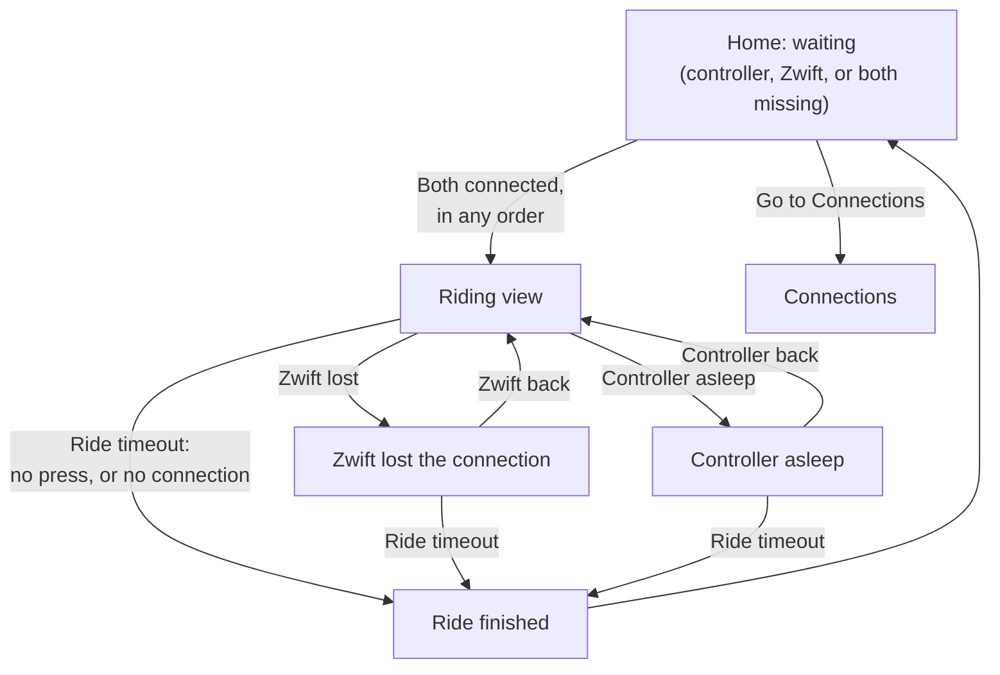

# Ride screens

!!! tldr "TL;DR"
    Ride is the home tab. It shows your controller, honest stats, your mapping, and whether Zwift can see you. There is no Start riding button: a ride starts by itself when a controller and Zwift are both connected, in any order. A brief loss of either does not end it. It ends when the app closes, or when the ride timeout (10 minutes by default, set in Settings) passes with no button press or with either connection missing. While riding you get one big readout of your last press. Problems are said in words: "Your controller is fine", "Wake your controller".

In the rules, "must", "should", and "may" have the meaning given in [how to read a spec](../index.md).

## Home

**What it is for:** the screen you see every day. It tells you that you are ready, or what is missing. The controller and Zwift can connect in any order. Until both are connected, Home says which is missing and suggests going to Connections.

**Content, top to bottom:** the VOLTAGE wordmark (`RideWordmark`), the screen title "Ready when you are" (`RidePageTitle`), your controller card (for example "Your Xbox controller is here", `RideControllerCard`), your stats (`RideStats`), your current mapping (`RideMappingCard`), and the Zwift status (`RideZwiftStatus`). There is no Start riding button.

*Example: "12 rides together, 1,086 shifts, riding since September."*

| Rule | ID |
|---|---|
| The title must be "Ready when you are". | SCR-RIDE-001 |
| The controller card must name your controller and say its state in words, such as "Your Xbox controller is here". | SCR-RIDE-002 |
| The stats must show only real values the app counts: rides together, shifts, and riding since. The app must count them and keep them between runs. Until there is something real to show, the app must hide the stats or say nothing. | SCR-RIDE-003 |
| The screen must show the selected mapping and let you change it by going to Buttons. | SCR-RIDE-004 |
| The Zwift status must say "Zwift is connected to Voltage Gamepad" when `IsZwiftConnected` is true. Zwift can see Voltage Gamepad whether or not a controller is connected. | SCR-RIDE-005 |
| Home must not have a **Start riding** button or any other control that starts a ride. The app must work without one. | SCR-RIDE-006 |
| The status text must be a live region and announce only changes. | SCR-RIDE-007 |
| When the controller, Zwift, or both are not connected, Home must say which is missing and offer a way to go to [Connections](connections.md). | SCR-RIDE-040 |
| Home must show the VOLTAGE wordmark at the top of the content, above the title (`RideWordmark`). In light mode, the letters VOLT must use the accent color and AGE must be near-black. In dark mode, all letters must be white. It must have the accessible name "VOLTAGE". | SCR-RIDE-034 |
| Home must have one level 1 heading, the title, and no other level 1 heading (UX-A-021). | SCR-RIDE-035 |

## Home, no controller

**What it is for:** every rider will open the app with the controller turned off, asleep, or unplugged. The screen says so and shows the way out.

**Copy:** title "Wake your controller", status "Looking for your controller...".

**Content:** a faded controller, the status, and two ways out: **Use a different controller**, and **Pair a new Bluetooth controller** (opens Windows settings). The Connections tab shows its dot.

| Rule | ID |
|---|---|
| When no controller is found after first run, Ride must show "Wake your controller" with "Looking for your controller..." and a faded controller. | SCR-RIDE-008 |
| It must offer two ways out: use a different controller, and pair a new Bluetooth controller. | SCR-RIDE-009 |
| The screen must return to Home by itself when the controller wakes, and announce that it is back. | SCR-RIDE-011 |

## Home, Zwift not connected

**What it is for:** the state at the start of every Zwift session. Zwift needs the three pairing steps again, so this is the most repeated task in the app.

**Copy:** "Zwift isn't connected yet", with a short version of the three steps. The main action is **Pair with Zwift**.

| Rule | ID |
|---|---|
| When Zwift is not connected, Home must say "Zwift isn't connected yet" instead of "Zwift is connected to Voltage Gamepad". | SCR-RIDE-012 |
| Home must show a short version of the three steps and make **Pair with Zwift** the main action. | SCR-RIDE-013 |
| **Pair with Zwift** must open the live pairing steps on [Connections](connections.md). | SCR-RIDE-014 |
| The Connections tab must show its dot while Zwift is not connected (UX-N-002). | SCR-RIDE-015 |

## Riding view

**What it is for:** a glance from the saddle. One big readout, nothing else competing.

A ride starts when the app knows both that a controller is connected and that Zwift is connected. It continues until you close the app, or until the ride timeout passes with no button press or with the controller or Zwift disconnected. A short loss of either connection does not end the ride. There is nothing to press to start or stop it.

**Content:** the big "You just pressed" readout (`RideLastPressStatus`, for example "Shift up, right bumper"), shifts this ride, and a quick reference of your main buttons.

| Rule | ID |
|---|---|
| A ride must start when a controller and Zwift are both connected, with no action from you. | SCR-RIDE-036 |
| A ride must end when the app closes, or when for the ride timeout in Settings (SCR-SET-012) no controller button has been pressed, or the controller has been disconnected, or Zwift has been disconnected. The default timeout is 10 minutes. | SCR-RIDE-037 |
| A ride must not end when the controller or Zwift disconnects for less than the ride timeout. The ride must return to the riding readout when the connection returns. | SCR-RIDE-041 |
| The riding view must have one big readout (the last press) readable at arm's length. | SCR-RIDE-016 |
| The riding view must show shifts this ride and a quick reference of the main buttons. | SCR-RIDE-017 |
| The riding view must have no **Stop riding** button. | SCR-RIDE-038 |
| The riding view must show the same problems (Zwift lost, controller asleep) as the other Ride states. | SCR-RIDE-020 |
| The riding view must follow platform limits in [Platforms](../ux/platforms.md). | SCR-RIDE-021 |

??? note "Edge cases"
    - At 200% text size the readout wraps to two lines before it shrinks.
    - You can resize the window by hand. The riding view must stay readable at every size.

## Zwift lost the connection

**What it is for:** tell you the controller is fine and Zwift is the one that needs a nudge.

**Copy:** "Your controller is fine." The ride continues until the ride timeout. Then: pick **Voltage Gamepad** under **Controls** in Zwift again.

| Rule | ID |
|---|---|
| When `IsZwiftConnected` becomes false while riding, the app must say "Your controller is fine" and explain what to pick in Zwift. | SCR-RIDE-023 |
| The app must announce the message right away. | SCR-RIDE-024 |
| The screen must not move focus when it appears. | SCR-RIDE-025 |

## Controller asleep while riding

**What it is for:** the controller went to sleep or disconnected mid-ride.

| Rule | ID |
|---|---|
| When the controller goes to sleep or disconnects while riding, the riding view must say so in words and say how to wake it. | SCR-RIDE-026 |
| The app must announce the message. | SCR-RIDE-027 |
| When the controller is back, the app must say so and return to the riding readout. | SCR-RIDE-028 |

## Ride finished

**What it is for:** show a short honest summary and, once, ask for support.

**Content:** time, shifts, and rides together. The one-time donation ask: **Chip in on Ko-fi** or **Maybe later**.

**Copy:** a short line about supporting the project.

| Rule | ID |
|---|---|
| The summary must show only real values: ride time, shifts, and rides together. | SCR-RIDE-029 |
| The donation ask must appear at most once, on a ride finished screen, with "Chip in on Ko-fi" and "Maybe later". | SCR-RIDE-030 |
| The ask must never block anything. "Maybe later" must dismiss it, and the app must not ask again. The app must keep that choice between runs. | SCR-RIDE-031 |
| The app must frame the ask as supporting the project. It must not claim impact the app cannot verify. | SCR-RIDE-032 |
| **Chip in on Ko-fi** must open the Ko-fi page, as it does on [Support](support.md). | SCR-RIDE-039 |

## Controller input on these screens

On Home and the riding view, a controller press goes to Zwift as mapped. See [Controller input](../ux/controller-input.md).

| Rule | ID |
|---|---|
| Controller input on Ride must follow UX-C-004. | SCR-RIDE-033 |

## Accessibility IDs

| ID | Where |
|---|---|
| `RideWordmark`, `RidePageTitle`, `RideControllerCard`, `RideStats`, `RideMappingCard`, `RideZwiftStatus`, `RideGoToConnectionsButton` | Home |
| `RideLastPressStatus` | Riding view |
| `NavConnectionsTab` | Name adds ", Zwift not connected" when the dot shows |

## Quoted strings

| Key | English text | Rule |
|---|---|---|
| `RideTitle` | Ready when you are | SCR-RIDE-001 |
| `RideControllerHere` | Your {0} is here | SCR-RIDE-002 |
| `ZwiftConnected` | Zwift is connected to Voltage Gamepad | SCR-RIDE-005 |
| `ZwiftNotConnected` | Zwift isn't connected yet | SCR-RIDE-012 |
| `RideNoControllerTitle` | Wake your controller | SCR-RIDE-008 |
| `RideNoControllerStatus` | Looking for your controller... | SCR-RIDE-008 |
| `RideWordmarkName` | VOLTAGE | SCR-RIDE-034 |
| `RideGoToConnections` | Go to Connections | SCR-RIDE-040 |
