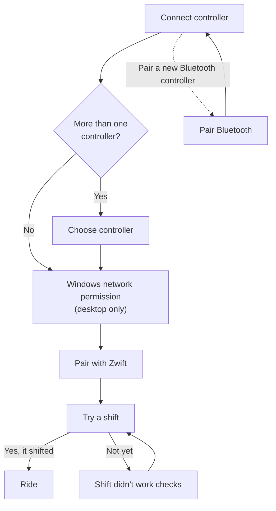

# Setup screens

!!! tldr "TL;DR"
    First run walks you through six short screens: connect a controller, choose one if there are several, pair a Bluetooth controller if needed, allow the Windows network permission, pair with Zwift, and try a shift. First run has no tab bar. The one main action on each screen moves you forward. Pairing with Zwift shows live progress where the app can tell.

In the rules, "must", "should", and "may" have the meaning given in [how to read a spec](../index.md).

## Connect controller

**What it is for:** show that the app can see your controller before you do anything else.

The first screen does something: it asks you to press any button, and the controller illustration lights the one you pressed. You are never asked what kind of controller you have.

*Example: you press the left bumper. The illustration lights it, and the app says "Got it. That's your left bumper."*

**Content, top to bottom:** the title, the line "Press any button on your controller.", the controller illustration, a status line, the main action **Continue**, and a link "Pair a new Bluetooth controller".

| State | What you see |
|---|---|
| Waiting | "Press any button on your controller." A neutral controller illustration. |
| Pressed | The pressed button lights up. Status: "Got it. That's your left bumper." Continue is enabled. |
| No controller found | "Looking for your controller..." with the same two ways out: use a different one or pair a new one. |

| Rule | ID |
|---|---|
| The first screen must say "Press any button on your controller." and light the pressed button on the illustration. | SCR-SETUP-001 |
| The screen must have one main action, Continue, enabled after the first press. | SCR-SETUP-002 |
| The app must announce the first press (`SetupPressAnyButtonStatus`). | SCR-SETUP-003 |
| The screen must offer "Pair a new Bluetooth controller" (`SetupPairBluetoothButton`). | SCR-SETUP-004 |
| The screen must not show a controller hint bar. A controller press only finds a button. | SCR-SETUP-005 |
| The screen must not use a drop-down list or a "Refresh list" button to pick a controller. | SCR-SETUP-006 |

## Choose controller

**What it is for:** pick one controller when several are connected. It appears only then.

The app uses one controller at a time. A left and right Joy-Con pair counts as one.

| Rule | ID |
|---|---|
| The screen must appear only when more than one controller is connected. | SCR-SETUP-007 |
| It must say "Press any button on the one you want." and pick the controller you press. | SCR-SETUP-008 |
| A left and right Joy-Con used together count as one controller. | SCR-SETUP-009 |

## Pair a new Bluetooth controller

**What it is for:** help you pair a controller that is not yet connected to this computer.

You pick the kind of controller, see the steps to put it in pairing mode, and then the app hands you to the operating system to finish pairing.

| Rule | ID |
|---|---|
| The screen must let you pick the kind of controller, then show its pairing-mode steps, then hand off to the operating system. | SCR-SETUP-010 |
| On Windows the hand-off must open Windows Bluetooth settings. | SCR-SETUP-011 |
| Other platforms must follow [Platforms](../ux/platforms.md). | SCR-SETUP-012 |
| The screen should link to the list of supported controllers once that list exists. | SCR-SETUP-013 |

## Windows network permission

**What it is for:** prepare you for the Windows firewall prompt, which appears the first time the app uses the network. Desktop only.

Zwift finds the app over your local network, so this permission matters.

**Copy:** "Windows will ask to let this app use your network. Choose Private networks."

| Rule | ID |
|---|---|
| On Windows the screen must appear before the firewall prompt appears. | SCR-SETUP-014 |
| It must say: "Windows will ask to let this app use your network. Choose Private networks." | SCR-SETUP-015 |
| Its main action must be Continue. | SCR-SETUP-016 |

??? note "Edge cases"
    If you cancel the Windows prompt, the app cannot be found by Zwift. The "Zwift can't find Voltage Gamepad" checks on [Connections](connections.md) say how to fix it in Windows Security.

## Pair with Zwift

**What it is for:** walk you through Zwift's Paired Devices screen so Zwift can see the app as **Voltage Gamepad**.

Zwift needs a short handshake every session. In Zwift's Paired Devices screen you do three steps:

1. Choose **Voltage Gamepad** as the **Power Source** for a moment.
2. Choose **Voltage Gamepad** under **Controls**.
3. Set **Power Source** back to your trainer.

The first time, Zwift also runs a short Zwift Ride tutorial.

**Content:** the three steps with pictures and the name to look for ("Voltage Gamepad"), a note that Zwift can run on this computer or on another device on the same network, a note about the one-time tutorial, a live status line, and the main action **Continue**.

### What the app can tell

| Step | What you do in Zwift | Can the app see it? | How |
|---|---|---|---|
| 1 | Power Source: Voltage Gamepad | Yes | The Direct Connect handshake completes (`HandshakeCompleted`, which sets `IsZwiftConnected`). |
| 2 | Controls: Voltage Gamepad | Not yet | The connection session can report that Zwift subscribed to the Controls characteristic (`IsSubscribed`). The app does not surface this yet. |
| 3 | Power Source: your trainer | No | The app cannot see it. It never ticks. It stays as the last instruction. |

| State | What you see |
|---|---|
| Waiting | "Waiting for Zwift..." No step is ticked. |
| Step 1 done | Step 1 ticks. "Step 2 of 3." |
| Step 2 done | Step 2 ticks once the app can detect it. |
| Last step | Step 3 is shown as an instruction that is never ticked. |
| Connected | "Zwift is connected" (`SetupZwiftStatus`). |

| Rule | ID |
|---|---|
| The screen must name **Voltage Gamepad** as the device to pick in Zwift, and give the steps in the order Power Source, Controls, then Power Source back to the trainer. | SCR-SETUP-017 |
| The screen must show live status: "Waiting for Zwift..." until `IsZwiftConnected` becomes true, then "Zwift is connected". | SCR-SETUP-018 |
| Step 1 must tick when the handshake completes. | SCR-SETUP-019 |
| Step 2 may tick when the app can see that Zwift subscribed to Controls. It must not tick unless the app knows. | SCR-SETUP-020 |
| Step 3 must never tick, because the app cannot detect it. It must stay as the last instruction. | SCR-SETUP-021 |
| The app must announce the current step ("Step 2 of 3") as a live region (`SetupZwiftStatus`). | SCR-SETUP-022 |
| The screen must mention the one-time Zwift Ride tutorial. | SCR-SETUP-023 |
| The screen must say that Zwift may run on this computer or on another device on the same network. | SCR-SETUP-024 |

## Try a shift

**What it is for:** prove it works. You shift in Zwift and the app asks if the gear changed.

**Copy:** "Did your gear change?" with **Yes, it shifted** and **Not yet**.

| State | What you see |
|---|---|
| Asking | "Did your gear change?" Yes, it shifted is the main action. Not yet is a secondary button. |
| Yes | You land on Ride. First run is over and the tabs appear. |
| Not yet | A short checks screen. It leads with what the app knows ("Shift up sent to Zwift, 2 seconds ago") so you can see the controller works. |

The checks screen lists four checks, in likely order:

1. You are pedaling.
2. Zwift has Voltage Gamepad under **Controls**.
3. Zwift has your trainer, not Voltage Gamepad, as **Power Source**.
4. Virtual shifting is on in Zwift.

Its one main action is **Try the shift again**. **Skip for now** stays available.

| Rule | ID |
|---|---|
| The screen must ask "Did your gear change?" with the choices "Yes, it shifted" and "Not yet". | SCR-SETUP-025 |
| "Yes, it shifted" must end first run and open Ride with the tabs visible. | SCR-SETUP-026 |
| "Not yet" must open a checks screen, not a dead end. | SCR-SETUP-027 |
| The checks screen must lead with what the app knows, such as "Shift up sent to Zwift, 2 seconds ago". It must show only values the app actually knows. | SCR-SETUP-028 |
| The checks screen must list the four checks above in that order, with one main action "Try the shift again" and a "Skip for now" option. | SCR-SETUP-029 |

## Controller input on these screens

On all setup screens, a controller press only finds or assigns a button. Moving on, going back, choosing, and answering a dialog such as the network permission explanation are done with touch, mouse, or keyboard (see [Controller input](../ux/controller-input.md)).

| Rule | ID |
|---|---|
| A controller press on a setup screen must only find a button. It must not move focus or press Continue. | SCR-SETUP-030 |

## Accessibility IDs

| ID | Where |
|---|---|
| `SetupPressAnyButtonStatus` | Connect controller |
| `SetupContinueButton` | Connect controller and following screens |
| `SetupPairBluetoothButton` | Connect controller |
| `SetupZwiftStatus` | Pair with Zwift |
