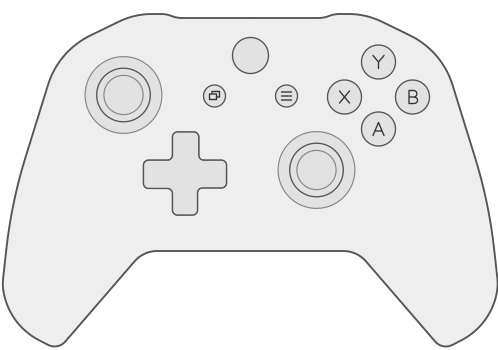
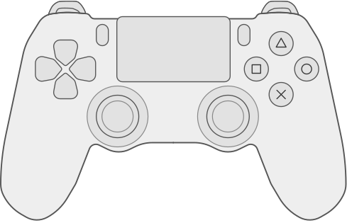
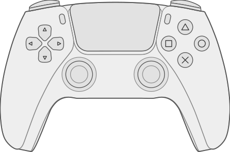
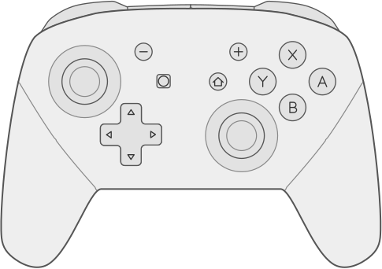
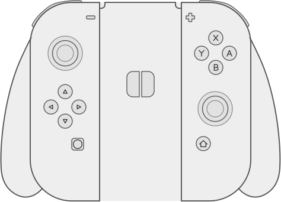

# Controller graphics style

!!! tldr "TL;DR"
    Controller drawings are minimalist, flat SVG files. A heavy outline, a few quiet fills, and shading only where a part is physically raised: the stick wells, the face buttons, and the D-pad. Every drawing uses the same classes, the same line weights, and the same ids, so one loader (and later Android and iOS) can light any kind.

In the rules, "must", "should", and "may" have the meaning given in [how to read a spec](../index.md). The [visual system](visual-system.md#illustration) says which kinds exist and how the app uses them. This page says how to draw one.

## Where the drawings live

Each kind with its own drawing has one folder, `docs/assets/controllers/<kind>/`, with the SVG and a `README.md` that credits the source art. The files sit in `docs/` so Windows, Android, and iOS build their native components from the same SVGs.

| Kind | Folder | Drawing |
|---|---|---|
| Xbox, and any kind without its own drawing | `xbox` | { width="320" } |
| PlayStation DualShock 4 | `playstation-dualshock4` | { width="320" } |
| PlayStation DualSense | `playstation-dualsense` | { width="320" } |
| Switch Pro | `switch-pro` | { width="320" } |
| Joy-Con pair (grip) | `joycon-pair` | { width="320" } |

## Look

| Rule | ID |
|---|---|
| A drawing must be flat and minimalist. It must use no gradients, no filters, no drop shadows, and no photographic detail. | UX-G-001 |
| Only parts that are physically raised or recessed may have shading: the stick wells, the face buttons, and the D-pad. Everything else must use the one flat body fill. | UX-G-002 |
| Line weight must follow the hierarchy in the table below. The body outline must be the darkest and thickest line. Each step down must be lighter, thinner, or both. | UX-G-003 |
| A drawing must not carry a color of its own. The colors in the SVG are a preview only: the app replaces them with the theme tokens in the table below, so the drawing works in light and dark mode. | UX-G-004 |
| The lit state must be the accent fill (`accent`) and nothing else. A lit shape must keep its outline. | UX-G-005 |
| Art must follow UX-V-061: original, or CC BY 4.0 with credit in ACKNOWLEDGEMENTS. When a drawing is redrawn from another artist's file, the folder's `README.md` must name the source and the license. | UX-G-006 |

### Classes, weights, and tokens

A shape picks its look from a class. The SVG's `<style>` block states the preview color and the stroke width. The app takes the widths from that block and the colors from the tokens.

| Class | Used for | Stroke width | Fill token | Stroke token |
|---|---|---|---|---|
| `ol` | Body outline and other outer outlines | 1.9 | none | `art-line` |
| `body-fill` | The flat body area | none | `art-body` | none |
| `ink` | A solid mark, such as a logo | none | `art-line` | none |
| `contour` | Quiet interior lines, such as the grip crease | 1.2 | none | `art-detail` |
| `key` | Buttons, bumpers, triggers, and the stick click | 1.35 | `art-shade` | `art-line` |
| `arm` | A D-pad arm: filled at rest, outlined when lit | 1.35 (only when lit) | `art-shade` | none at rest; `art-line` when lit |
| `well` | The ring a stick sits in | 1.2 | `art-shade` | `art-detail` |
| `stick` | The stick ring that moves | 1.35 | `art-shade` | `art-line` |
| `cap` | The inner ring of the stick, also the stick click | 1.2 | `art-shade` | `art-detail` |
| `glyph` | A symbol drawn on a key | 1.35, round caps | none | `art-glyph` |

A drawing that has an `ol` rule in its style block is flat art. The loader reads that rule to know which mode to use.

## Construction

| Rule | ID |
|---|---|
| A stick must be three parts: a `well` ring, a `stick` ring, and a `cap` ring, in that order from the outside in. The `stick` and `cap` rings must move together. | UX-G-010 |
| A stick must say how far it travels with `data-travel`, in drawing units. A drawing with a smaller body, such as the Joy-Con pair, must use a smaller travel. | UX-G-011 |
| A symbol on a button must be a `glyph` path inside the button, with `data-for` set to the `ControllerInput` it marks. It must light with its button. | UX-G-012 |
| Buttons the app does not map, such as Home and Capture, may be drawn, but they must have no `id`, so they never light. | UX-G-013 |
| D-pad arms must be separate shapes, one per direction, with the ids `DPadUp`, `DPadDown`, `DPadLeft`, and `DPadRight`. | UX-G-014 |
| Shapes must be drawn in back-to-front order: the shoulder shapes first, then the body fill, the outlines, and the controls. A shoulder shape must be covered by the body at the edge where they meet, and the body outline must stay on top. | UX-G-015 |
| A drawing may extend above or beside the body with a negative origin in its `viewBox`, so that nothing is clipped. | UX-G-016 |
| A drawing for a kind that is symmetrical must be built from one half and mirrored exactly, so the two halves match to the unit. | UX-G-017 |

## The id contract

Ids follow UX-V-068: an interactive shape's `id` is its `ControllerInput` name. This is the whole contract between the art and the apps.

| Id | Shape |
|---|---|
| `A`, `B`, `X`, `Y` | The four face buttons, by position (right, bottom, left, top on the Xbox drawing). |
| `DPadUp`, `DPadDown`, `DPadLeft`, `DPadRight` | The D-pad arms. |
| `View`, `Menu` | The two center buttons. |
| `LeftBumper`, `RightBumper` | The shoulder buttons (L1 and R1, or L and R). |
| `LeftTrigger`, `RightTrigger` | The triggers (L2 and R2, or ZL and ZR). |
| `LeftTriggerFill`, `RightTriggerFill` | The fill of an analog trigger. Only analog triggers have one. |
| `LeftThumbstick`, `RightThumbstick` | The moving stick group. |
| `LeftThumbstickClick`, `RightThumbstickClick` | The stick click. |

## Bumpers and triggers

The shoulder shapes follow one pattern across kinds, so a rider sees the same thing on every controller.

| Rule | ID |
|---|---|
| A bumper must be a closed shape with the `key` class and its id. It must light when pressed (UX-V-062). | UX-G-020 |
| A trigger must sit behind its bumper and lie against the body edge, further out than the bumper. A trigger must be taller than its bumper: about twice the height on drawings where the trigger has its own space. | UX-G-021 |
| An analog trigger must have an outline shape with the `key` class and its id, and a fill shape with the id ending in `Fill`. The fill must be drawn on top of the outline, in the same shape, and have no outline of its own. The app reveals it with a clip that rises from the bottom, so a fill always rises straight up, even on a slanted shape (UX-V-063). Pulling an analog trigger must not light its outline; only selecting it does (UX-V-060). | UX-G-022 |
| A digital trigger must be one `key` shape with its id, and no fill shape. It must light fully when pressed and nothing else (UX-V-064). | UX-G-023 |
| Shoulder shapes must be smooth: curves, not straight runs and corners. Where a shape is built from an arch, the arch must be symmetrical about its own center, with a flat top. | UX-G-024 |
| A shoulder shape must be centered on the face button that sits below it on the same side (the up arrow or Triangle), when the drawing has one. The two sides must be exact mirrors. | UX-G-025 |
| A bumper must reach half the height of its trigger. | UX-G-026 |
| A digital trigger must be a band as thick as the bumper lip on the Joy-Con pair, drawn around and behind the bumper (UX-G-023). The band must end at the body outline on its outer end and flush with the end of the bumper on its inner end. | UX-G-027 |

??? note "Edge cases"
    - The DualSense has one shape on each side that splits into two: a narrow band along the body for the bumper and the dome above it for the trigger. The trigger fill rises straight up inside the dome, which is slanted.
    - The Xbox and DualShock 4 arches are built as flattened superellipses (exponent 3.6). The Xbox arches lie at an angle, so they are measured along the body outline and mirror about the vertical center of the drawing.
    - The Switch Pro bumper is thick, and its ZL and ZR are thin bands around it. This follows the real controller, where the bumper is a large cap and the trigger a smaller lip behind it.

## Checking a drawing

Before a drawing is added or changed:

1. Open the SVG in a browser and check it on both a light and a dark page.
2. Confirm every interactive id exists once, and that no id exists that the kind does not have.
3. Run the diagram tests. They check ids, classes, trigger fills, stick travel, and that every kind loads.
4. Render the resting, lit, and active states in both themes. The Debug build can write these as PNGs when `windows/.snapshots/enable` exists.
