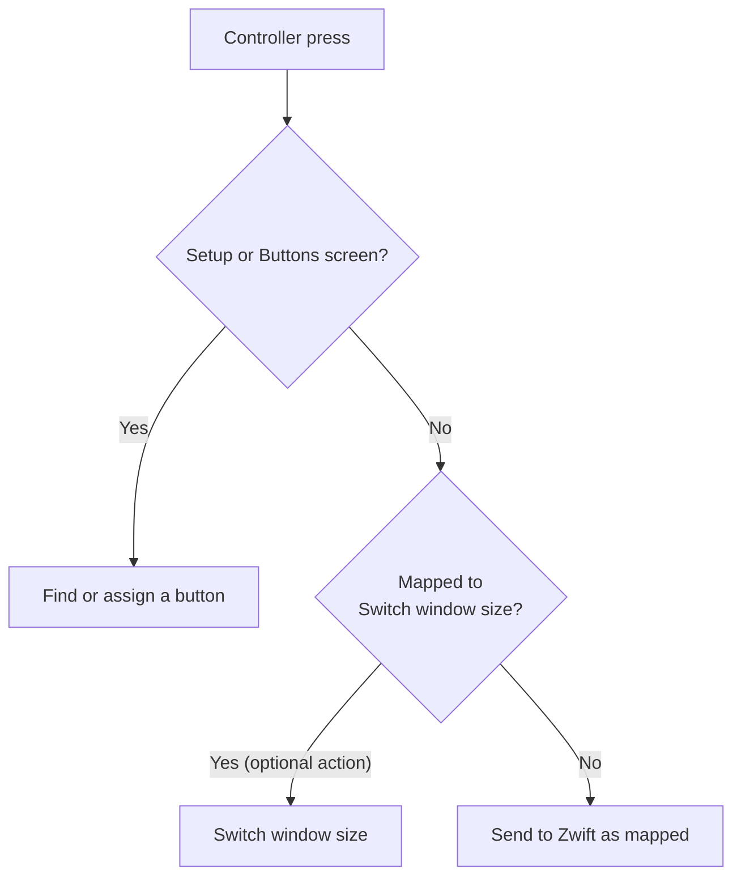

# Controller input

!!! tldr "TL;DR"
    A controller press has exactly one meaning on each screen. On setup and Buttons screens, a press finds or assigns a button. Everywhere else, a press goes to Zwift as mapped. A hold on a mapped button reaches Zwift as a hold. The app shows the right button glyphs for your controller.

In the rules, "must", "should", and "may" have the meaning given in [how to read a spec](../index.md).

## One meaning per screen

Your controller does different jobs in different places. To keep that clear, each kind of screen gives it one job, and the screen never mixes two. You use touch, mouse, or keyboard to move around the app and answer its dialogs.

| Where | What a press means |
|---|---|
| Setup and Buttons screens | Find or assign a button. |
| Everywhere else | The press goes to Zwift as mapped. |

The app may offer **Switch window size** (Full, then Float, then Mini) as an app action that can be mapped to a controller input, such as View. It is the only app action a controller input may trigger. All other mapped inputs go to Zwift.

*Example: on the Buttons screen you press the right bumper. The app selects "Right bumper" and shows what it does. It does not shift gears.*

| Rule | ID |
|---|---|
| A controller press must have exactly one meaning on each screen. | UX-C-001 |
| On setup and Buttons screens, a press must only find or assign a button. It must not navigate, save, or go back. | UX-C-002 |
| On setup and Buttons screens, the app must not show a controller hint bar. The screen's own hint says "Press a button on your controller to select it." | UX-C-003 |
| The app may offer **Switch window size** (Full, then Float, then Mini) as an app action that can be mapped to a controller input, such as View. It is the only app action a controller input may trigger. The app must send every other mapped input to Zwift. | UX-C-004 |
| The app's own dialogs must work with a mouse, a keyboard, and touch. See `CFG-038`. | UX-C-006 |

??? note "Edge cases"
    - Shifting in Zwift is not affected by which screen is open. The app keeps sending your mapped functions to Zwift.
    - The file picker for importing a mapping is the standard system dialog. It works with a mouse and keyboard.

## Holding a button

| Rule | ID |
|---|---|
| The app must pass a hold on a mapped button to Zwift as a hold, so Zwift's own hold actions work (Ride On to nearby riders, Power-up to skip a workout block). It should say so next to those functions. | UX-C-008 |

??? note "Edge cases"
    Zwift's hold actions still need a hold. The app does not add its own hold behavior.

## Button glyphs

The app detects your controller family and shows the matching glyphs. You are never asked which one you have.

| Family | Face buttons shown |
|---|---|
| Xbox | A, B, X, Y |
| PlayStation | ✕, ○, □, △ |
| Nintendo | A, B, X, Y, with A and B in the swapped positions |
| Any other family | The Xbox layout and Xbox names |

| Rule | ID |
|---|---|
| The app must detect the controller family automatically and must not ask you to choose it. | UX-C-009 |
| Every button label and hint must use the glyphs of the detected family. | UX-C-010 |
| For Nintendo controllers, the app must show A and B in Nintendo's swapped positions. | UX-C-011 |
| For a controller of an unknown family, the app must assume the Xbox layout and use Xbox names. It must not fall back to generic button names. | UX-C-012 |

## Focus in dialogs

| Rule | ID |
|---|---|
| When a dialog opens, focus must move into it, and when it closes, focus must return to what opened it. | UX-C-015 |

## One controller at a time

| Rule | ID |
|---|---|
| The app must use one controller at a time. | UX-C-016 |
| A left and right Joy-Con used together count as one controller. This is an exception to the one-controller-at-a-time rule. | UX-C-017 |
| When more than one controller is connected, the app must ask you to press a button on the one you want. | UX-C-018 |

## Background input

The app keeps reading your controller while it is not the focused window, so you can ride with Zwift in front. How this works depends on the platform. See [Platforms](platforms.md).

| Rule | ID |
|---|---|
| On Windows the app must keep reading controller input when another window (such as Zwift) has focus. | UX-C-019 |
| If a platform cannot read input in the background, the app must say so in plain words and keep the screen open. | UX-C-020 |
