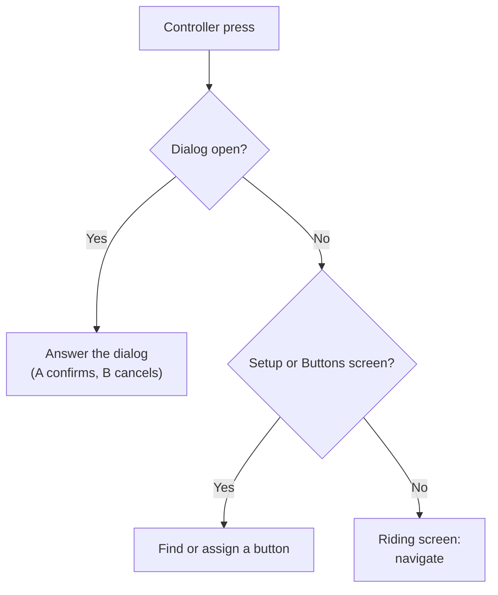

# Controller input

!!! tldr "TL;DR"
    A controller press has exactly one meaning on each screen. On setup and Buttons screens, presses find or assign buttons. While riding, the controller navigates. In a dialog, the controller answers it (A confirms, B cancels). A hold on a mapped button reaches Zwift as a hold. The app shows the right button glyphs for your controller.

In the rules, "must", "should" and "may" have the meaning given in [how to read a spec](../index.md).

## One meaning per screen

Your controller does different jobs in different places. To keep that clear, each kind of screen gives it one job, and the screen never mixes two.

| Where | What a press means | Controller hint bar |
|---|---|---|
| Setup and Buttons screens | Find or assign a button. Navigation, save and back use touch, mouse or keyboard. | None |
| Riding screens | The controller navigates. View switches the window size (Full, then Float, then Mini). | Not needed |
| Dialogs | The controller answers the dialog. A confirms, B cancels. | A and B hint, with a focus ring |

*Example: on the Buttons screen you press the right bumper. The app selects "Right bumper" and shows what it does. It does not move focus or shift gears.*

| Rule | ID |
|---|---|
| A controller press must have exactly one meaning on each screen. | UX-C-001 |
| On setup and Buttons screens, a press must only find or assign a button. It must not navigate, save or go back. | UX-C-002 |
| On setup and Buttons screens, the app must not show a controller hint bar. The screen's own hint says "Press a button on your controller to select it." | UX-C-003 |
| On riding screens, the controller must navigate, and View must switch the window size from Full to Float to Mini. | UX-C-004 |
| While a dialog is open, the controller must be able to answer it. A confirms and B cancels. The dialog must show a focus ring and an A and B hint. | UX-C-005 |
| All the app's own dialogs must also work with a mouse and keyboard. See `CFG-038`. | UX-C-006 |

??? note "Edge cases"
    - Shifting in Zwift is not affected by any of this. The app keeps sending your mapped functions to Zwift while you navigate its own screens.
    - The file picker for importing a mapping is the standard Windows dialog. It is not a dialog the app can answer with a controller (see `CFG-038`).

## Holding a button

| Rule | ID |
|---|---|
| The app must pass a hold on a mapped button to Zwift as a hold, so Zwift's own hold actions work (Ride On to nearby riders, Power-up to skip a workout block). It should say so next to those functions. | UX-C-008 |

??? note "Edge cases"
    Zwift's hold actions still need a hold. The app does not add its own hold behavior.

## Button glyphs

The app detects your controller family and shows the matching glyphs. You are never asked which one you have.

| Family | Face buttons shown |
|---|---|
| Xbox | A, B, X, Y |
| PlayStation | ✕, ○, □, △ |
| Nintendo | A, B, X, Y, with A and B in the swapped positions |

| Rule | ID |
|---|---|
| The app must detect the controller family automatically and must not ask you to choose it. | UX-C-009 |
| Every button label and hint must use the glyphs of the detected family. | UX-C-010 |
| For Nintendo controllers, A and B must be shown in Nintendo's swapped positions. | UX-C-011 |
| For a controller of an unknown family, the app should show plain generic names. | UX-C-012 |

## Focus ring

| Rule | ID |
|---|---|
| Wherever the controller navigates, every focusable element must show a focus ring (3 px, 2 px offset, focus token). | UX-C-013 |
| The focus ring must be the most visible thing on the screen there. | UX-C-014 |
| When a dialog opens, focus must move into it, and when it closes, focus must return to what opened it. | UX-C-015 |

## One controller at a time

| Rule | ID |
|---|---|
| The app must use one controller at a time. | UX-C-016 |
| A left and right Joy-Con pair must count as one controller. | UX-C-017 |
| When more than one controller is connected, the app must ask you to press a button on the one you want. | UX-C-018 |

## Background input

The app keeps reading your controller while it is not the focused window, so you can ride with Zwift in front. How this works depends on the platform. See [Platforms](platforms.md).

| Rule | ID |
|---|---|
| On Windows the app must keep reading controller input when another window (such as Zwift) has focus. | UX-C-019 |
| If a platform cannot read input in the background, the app must say so in plain words and keep the screen open. | UX-C-020 |
