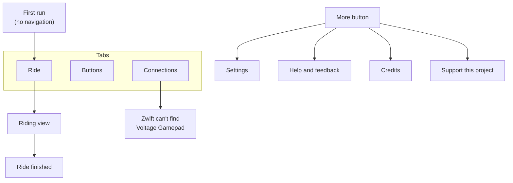

# Navigation

!!! tldr "TL;DR"
    Three tabs that never change (Ride, Buttons, Connections) plus a floating More button (⋯) that opens Settings, Help and feedback, Credits and Support this project. The tabs move with screen size. The More button never moves. First run has no navigation.

In the rules, "must", "should" and "may" have the meaning given in [how to read a spec](../index.md).

## App map

## Three tabs

The tabs are always in the same order. They are the same on every screen after first run.

| Tab | What lives there |
|---|---|
| **Ride** | Home ("Ready when you are"), the live riding view, ride finished. |
| **Buttons** | Layouts, buttons, sticks and triggers. |
| **Connections** | Your controller (use a different one, pair a new one), Zwift (status, pair Voltage Gamepad, the three steps) and "Zwift can't find Voltage Gamepad". |

| Rule | ID |
|---|---|
| The tabs must be Ride, Buttons and Connections, in that order, on every screen after first run. | UX-N-001 |
| The Connections tab must show an accent-ink dot whenever Zwift is not connected, so the warning is visible from any tab. The dot must also have words in its accessible name. | UX-N-002 |
| The tab bar must not hold page actions. The one accent action of a screen must never be in the navigation. | UX-N-003 |

## The More button

A small floating button with a ⋯ (more) icon. It is not a hamburger: there is no side menu behind it. It opens a menu downward with Settings, Help and feedback, Credits and Support this project.

| Rule | ID |
|---|---|
| The More button must always sit at the top right of the content area. It must never move with screen size. | UX-N-004 |
| The button must be a 40 px circle with a 48 px hit area, in a neutral color (not accent). | UX-N-005 |
| On desktop it must sit just below the title bar, never in it. | UX-N-006 |
| The button must float over the content. It must not reserve its own row or column. Content starts at the normal top margin and may scroll under it. Only the area directly beneath it must stay free of other controls. | UX-N-007 |
| The menu must list Settings, Help and feedback, Credits and Support this project, in that order. | UX-N-008 |
| Each menu item must open a pushed screen with a back button. The tabs stay visible with none selected. | UX-N-009 |

## Where the tabs go

| Screen size | Tabs |
|---|---|
| Phone, portrait or landscape | Floating bottom bar, full width. |
| iPad, portrait or landscape | Floating tab bar at top center, with the More button on the same row. |
| Android tablet and other windows 600 dp or wider | Side rail on the left. |
| Desktop, wide (about 1000 px and up) | Sidebar with icons and labels. The More button sits just below the title bar, right-aligned. |
| Desktop, medium (about 640 to 1000 px) | Compact rail. |
| Desktop, narrow (under about 640 px, for example snapped beside Zwift) | Bottom bar, like the phone. |

| Rule | ID |
|---|---|
| The tabs must be placed as in the table above. | UX-N-010 |
| The layout must switch continuously as the window is resized, with no manual setting. | UX-N-011 |

## First run, dialogs, windows

| Rule | ID |
|---|---|
| First run must have no navigation. The flow is connect controller, then choose or pair if needed, then pair with Zwift, then try a shift, then it lands on Ride. | UX-N-012 |
| Dialogs and sheets must cover the navigation. | UX-N-013 |
| The Float and Mini windows must have no navigation. | UX-N-014 |
| Page actions must stay on the page (Save on Buttons, Start riding on Ride). | UX-N-015 |
| A pushed screen must have a back button, and the back button must return to the screen it was opened from. | UX-N-016 |

??? note "Edge cases"
    - Only the very first run hides the tabs. Choosing a different controller or pairing a new one later happens inside the Connections tab, with the tabs visible.
    - Pushed screens (Settings, Help and feedback, Credits, Support this project) keep the tabs visible with none selected.

## Implementation status

Not implemented yet. The current Windows app has a custom title bar, a back button, a side menu with "Controller Setup" and "About", and a Settings button in the footer of the menu. It has no tabs and no More button.
