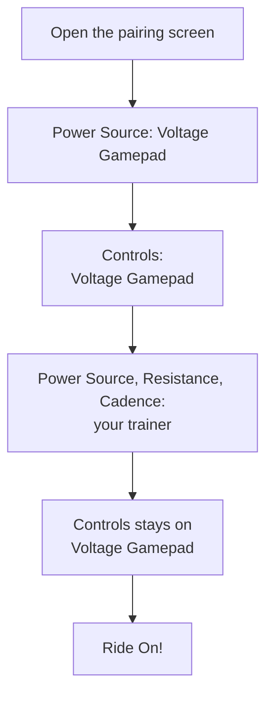

# Pair with Zwift

The app shows up in Zwift as a controller named **Voltage Gamepad**. You connect to it on Zwift's device pairing screen.

## Same computer or a different device?

Both work.

- **Same computer:** run the app and Zwift on the same Windows PC.
- **Different devices:** run the app on a Windows PC and Zwift on another device, such as a Mac, tablet, phone or Apple TV. Both devices must be on the **same local network** (for example the same home Wi-Fi).

## Step by step

1. Start Game Controller for Zwift and pick your controller (see [Install and first run](install.md)).
1. Start Zwift and open the **device pairing screen**.
1. Under **Power Source**, choose **Voltage Gamepad** first.
1. Switch to **Controls**, Voltage Gamepad will now be an option. Select it.
1. Now switch **Power Source** and other devices like **Resistance** and **Cadence** to your real devices.
1. Keep **Controls** on **Voltage Gamepad**.
1. Start riding!

!!! tip "Why choose Power Source first?"
    Picking Voltage Gamepad as the Power Source triggers the communication handshake between Zwift and this app. This handshake needs to happen at least once per Zwift session to enable Controls integration. Once Controls is filled in, you can select your real Power Source. Voltage Gamepad does not send power or cadence, your trainer must provide those.

## What connected looks like

- On the pairing screen, **Controls** shows **Voltage Gamepad** as connected.
- In a ride, pressing your shift buttons changes gear, and pressing your navigation buttons moves through Zwift's menus.
- The app's log file records `DIRCON RideOn handshake completed` when Zwift has connected. See [Troubleshooting](troubleshooting.md#find-and-share-the-log-file) for where to find the log.

If Voltage Gamepad does not appear, see [Troubleshooting](troubleshooting.md).

## Next step

Choose what each button does in [Map your controller](map-your-controller.md).
