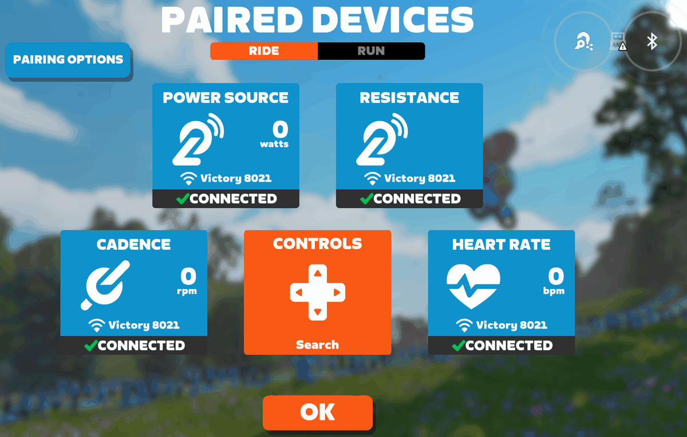
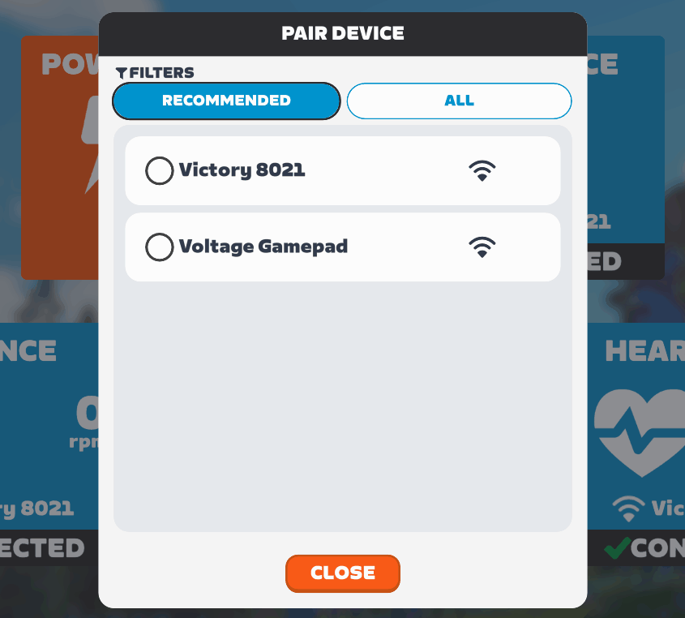
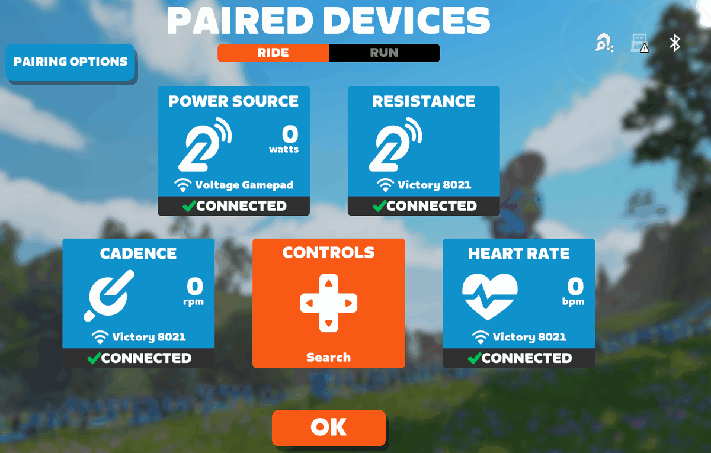
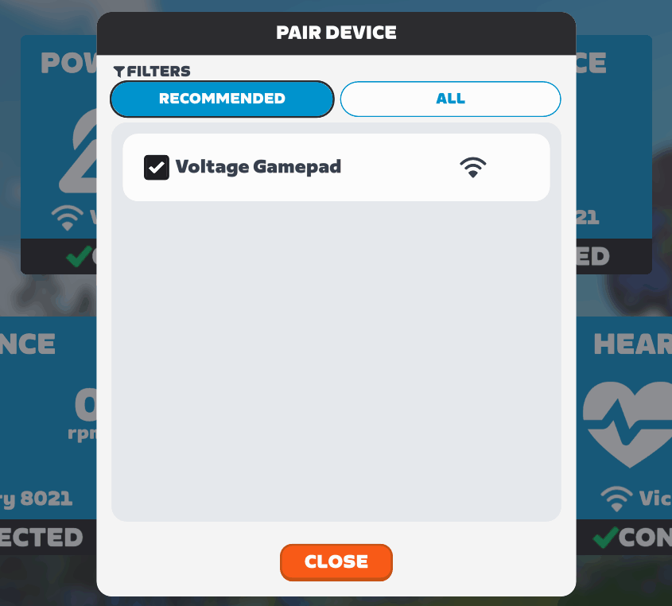
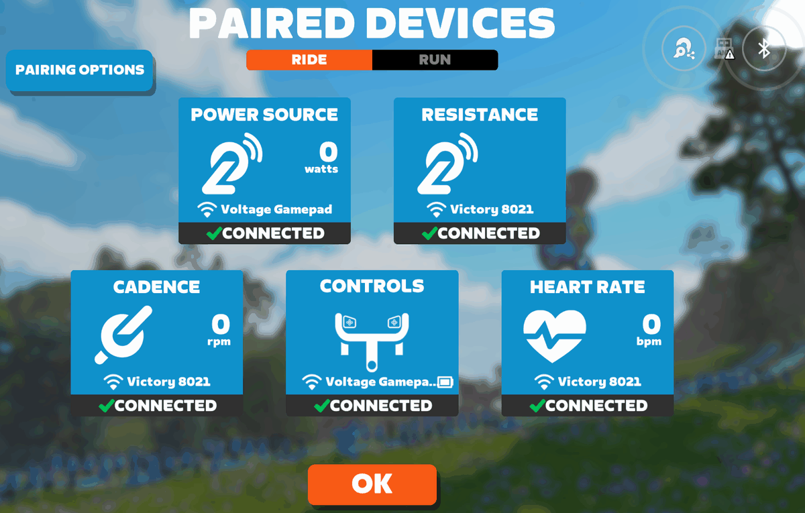
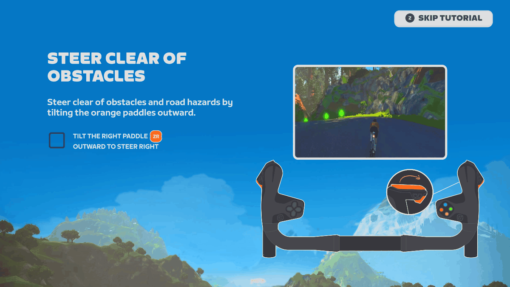
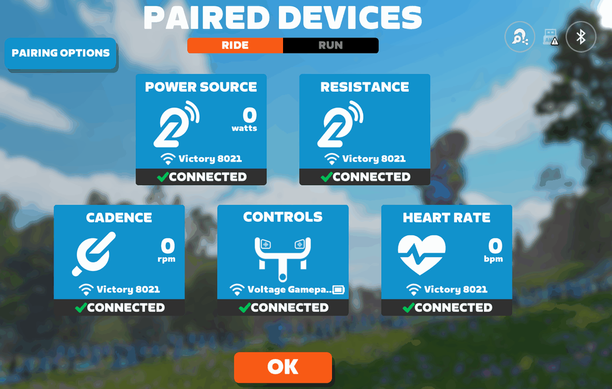
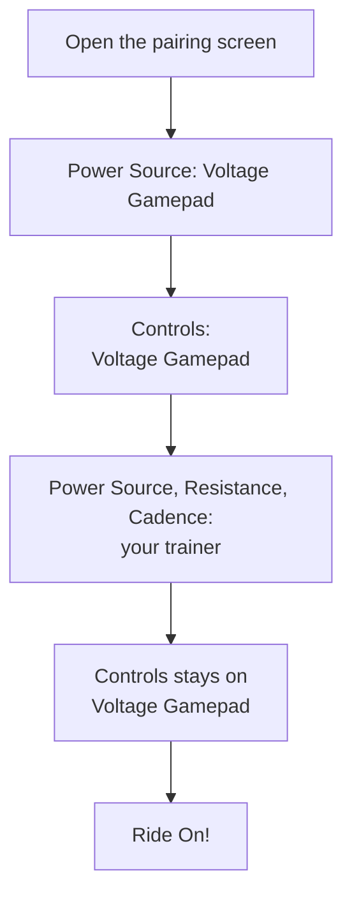

# Pair with Zwift

!!! tldr "TL;DR"
    Start the app and pick your controller. In Zwift's **Paired Devices** screen, choose **Voltage Gamepad** as the **Power Source** for a moment. Then choose **Voltage Gamepad** under **Controls**. Finally, set **Power Source** back to your trainer. The first time, Zwift also runs a short Zwift Ride tutorial.

The app shows up in Zwift as a Zwift Ride controller named **Voltage Gamepad**. You connect to it on Zwift's **Paired Devices** screen.

## Same computer or a different device?

Both work.

- **Same computer:** run the app and Zwift on the same Windows PC.
- **Different devices:** run the app on a Windows PC and Zwift on another device, such as a Mac, tablet, phone or Apple TV. Both devices must be on the **same local network** (for example the same home Wi-Fi).

## Step by step

### 1. Start the app and pick your controller

Start Game Controller for Zwift and choose your controller from the list (see [Install and first run](install.md)). Keep the app running while you ride.

### 2. Open the Paired Devices screen

Start Zwift and go to the **Paired Devices** screen. Your trainer already shows as **Connected**, but the **Controls** tile still says **Search**.

<figure markdown="span">
  { loading=lazy }
  <figcaption>Before pairing: Controls says Search.</figcaption>
</figure>

### 3. Pick Voltage Gamepad as the Power Source

Click the **Power Source** tile. The **Pair Device** list opens. Select **Voltage Gamepad**, then click **Close**.

<figure markdown="span">
  { loading=lazy }
  <figcaption>The Power Source list shows your trainer and Voltage Gamepad.</figcaption>
</figure>

### 4. Check the Power Source tile

The **Power Source** tile now shows **Voltage Gamepad** as connected. This is only for a moment. Voltage Gamepad sends no power, so the tile shows 0 watts.

<figure markdown="span">
  { loading=lazy }
  <figcaption>Voltage Gamepad is the Power Source for now.</figcaption>
</figure>

!!! tip "Why choose Power Source first?"
    Picking Voltage Gamepad as the Power Source triggers the communication handshake between Zwift and this app. This handshake needs to happen at least once per Zwift session to enable Controls integration. Once Controls is filled in, you can select your real Power Source. Voltage Gamepad does not send power or cadence. Your trainer must provide those.

### 5. Pick Voltage Gamepad under Controls

Click the **Controls** tile. In the **Pair Device** list, check **Voltage Gamepad**, then click **Close**.

<figure markdown="span">
  { loading=lazy }
  <figcaption>Check Voltage Gamepad in the Controls list.</figcaption>
</figure>

### 6. Check the Controls tile

The **Controls** tile turns blue, shows a Zwift Ride handlebar icon and says **Voltage Gamepad** with **Connected** below it.

<figure markdown="span">
  { loading=lazy }
  <figcaption>Controls is connected to Voltage Gamepad.</figcaption>
</figure>

### 7. Go through the Zwift Ride tutorial (first time only)

The first time Zwift sees a Zwift Ride, it runs a short tutorial. It starts with a welcome screen. Then it shows one screen per action, such as steering, braking and shifting. Do each action with your game controller, using the buttons you mapped in [Map your controller](map-your-controller.md). If you want to skip it, click Skip Tutorial in the top right corner or select the Z-mapped button on your controller.

<figure markdown="span">
  { loading=lazy }
  <figcaption>A tutorial screen: use your Steer right input.</figcaption>
</figure>

### 8. Set the Power Source back to your trainer

Click the **Power Source** tile again. Select your trainer or power meter, then click **Close**. Check that **Resistance** and **Cadence** also show your real devices. Keep **Controls** on **Voltage Gamepad**. Click **OK** and start riding!

<figure markdown="span">
  { loading=lazy }
  <figcaption>Done: your trainer is the Power Source and Voltage Gamepad is the controller.</figcaption>
</figure>

## Next time

The tutorial only runs once. The handshake is needed once per Zwift session, though. So each time you start Zwift, repeat steps 3 to 6 and step 8: pick Voltage Gamepad as the Power Source, pick it under Controls, then set the Power Source back to your trainer.

## What connected looks like

- On the pairing screen, **Controls** shows **Voltage Gamepad** as connected.
- In a ride, pressing your shift buttons changes gear, and pressing your navigation buttons moves through Zwift's menus.
- The app's log file records `DIRCON RideOn handshake completed` when Zwift has connected. See [Troubleshooting](troubleshooting.md#find-and-share-the-log-file) for where to find the log.

If Voltage Gamepad does not appear, see [Troubleshooting](troubleshooting.md).

## Next step

Choose what each button does in [Map your controller](map-your-controller.md).
